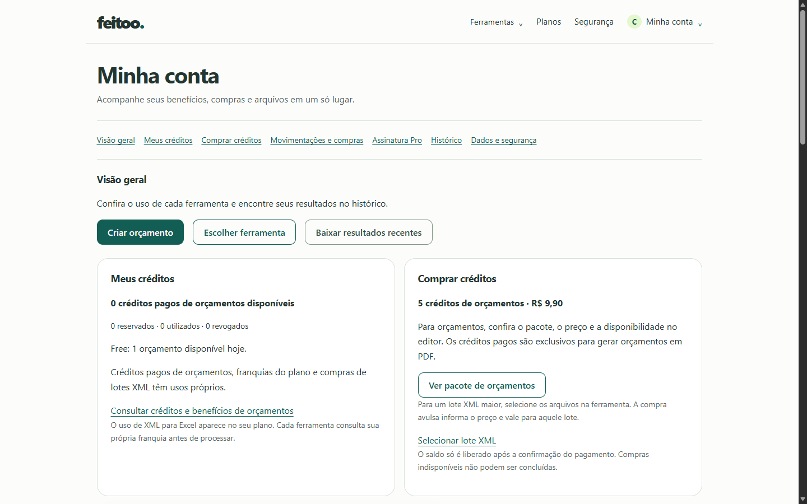
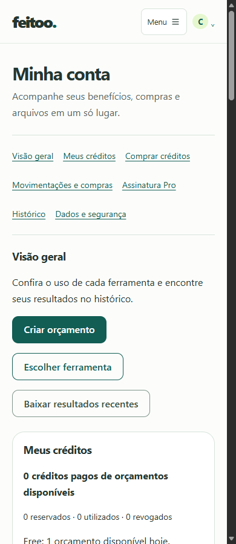

# Feitoo — auditoria da Minha Conta, assinatura, créditos e UX/UI

**Data:** 28/10/2026, America/Sao_Paulo. **Escopo:** implementação local atual, sem alteração do código do produto. Destino: revisão e preparação de um segundo prompt de implementação.

## 1. Resumo executivo

**O problema não é apenas visual. Há caminhos de navegação quebrados, compra de créditos inacessível diretamente na conta, recuperação incompleta de assinatura e inconsistências de atualização de benefícios.** Reorganizar os cards sem corrigir essas condições manteria os principais obstáculos comerciais.

Os achados mais relevantes são:

1. **Os links internos da conta saem da conta.** Com `<base href="/">`, `href="#credits-title"` resolve para `/#credits-title`. Um clique real em “Meus créditos” abriu a home. A mesma construção aparece nos sete links de navegação e nos atalhos internos de histórico/créditos.
2. **Não é possível comprar o pacote de cinco créditos por R$ 9,90 diretamente em `/conta`.** O card encaminha ao editor; a instância de `QuotationCommercePanel` da conta não é editora e não renderiza botão de compra. Mesmo no editor habilitado, a oferta só aparece quando a franquia Free/Pro se esgota.
3. **O estado `incomplete` oculta “Assinar Feitoo Pro” e oferece somente o Portal.** O backend admite retomar a tentativa quando ainda não existe uma assinatura remota. O contrato de resumo não distingue essa situação de uma assinatura remota com cobrança pendente. Uma tentativa interrompida pode ficar sem caminho apropriado na interface.
4. **Falha inicial na consulta da assinatura deixa o usuário sem ação de recuperação específica.** A tela diz que pode consultar novamente, mas o botão de assinatura só existe no modo de confirmação. “Consultar uso novamente” não recarrega a assinatura.
5. **A ativação Pro atualiza o uso XML, mas não os benefícios de orçamentos.** Reproduziu-se “Feitoo Pro — Ativo” junto de franquia Free esgotada no mesmo documento.
6. **Sessão expirada em cobrança recebe tratamento diferente do histórico.** O interceptor limpa a autenticação; a conta permanece na tela com dados antigos e erro genérico de Stripe. No histórico, há redirecionamento ao login.
7. **A densidade afasta as ações comerciais da primeira dobra.** No cenário Free vazio, a página inteira mede aproximadamente 3.242 px em desktop e 5.241 px em 390 px. O botão de assinatura começa em y≈1.997 px no mobile. Com dez processamentos na página, o bloco de compras de orçamentos começa abaixo de 7.800 px em 320 px.

**Não foi comprovado defeito no Stripe Live.** A configuração local disponível é TEST; os dois Price IDs de créditos estão ausentes e as flags de geração/compra não estão definidas, usando o default `false`. Isso explica a indisponibilidade local, mas não comprova os valores da implantação. O Portal Live, seus recursos e a entrega de webhooks em produção permanecem não verificados.

**Validação realizada:** build Angular atual; 101 testes frontend aprovados; 48 testes backend aprovados, com 516 assertions; navegador real Microsoft Edge; 77 screenshots únicos; 17 verificações de navegador registradas. Dados pessoais, saldos, pedidos, pagamentos e respostas comerciais usados no navegador são inteiramente simulados. Nenhum checkout real, alteração Stripe, deploy, commit ou push.

### Método, fontes e limites da evidência

| Marca | Significado |
| --- | --- |
| **C** | Comprovado no código atual; pode depender de uma condição de entrada explicitada. |
| **B** | Reproduzido no navegador com o frontend atual e APIs locais simuladas. |
| **T** | Coberto por testes existentes executados em ambiente isolado. |
| **H** | Hipótese operacional ou dependência externa ainda não verificada. |

Checkout e Portal foram clicados de verdade no DOM e os POSTs foram registrados, recebendo respostas simuladas de erro. **Isso comprova o caminho do clique até o endpoint e a reação da UI; não comprova a abertura nem o funcionamento de uma sessão Stripe Live.** Os redirects válidos são cobertos pelos testes de serviço/componente, sem pagamento externo.

O build utilizou `ng build --configuration development --output-path dist/account-audit`, sem executar `configure-launch.mjs`. A flag pública existente `quotationEnabled=false` foi preservada. O navegador serviu o shell CSR gerado pelo build e as APIs em localhost, com HTTPS externo bloqueado. Há uma mensagem de diagnóstico “API conectada.” própria do modo development nas capturas; ela não deve ser atribuída à interface de produção.

Os fixtures podem representar uma oferta backend disponível mesmo com a flag pública local desligada: isso foi deliberado para separar o contrato de dados da condição real do bundle. Não é observação da configuração operacional. O teste do editor preserva a flag desligada: o componente comercial não aparece. Condições do editor habilitado foram verificadas pelo código e testes existentes, sem ativar flags.

As cinco larguras usam viewport de **900 px de altura**, escala 1 e fuso São Paulo. Os testes de mobile são de layout com viewport estreito no Edge desktop; não equivalem a testes físicos em iOS/Android, leitor de tela ou navegação por toque.

Fontes de evidência:

| ID | Arquivo / referência principal |
| --- | --- |
| S1 | [AccountPage TS](../feitoo-web/src/app/features/account/pages/account-page.ts), especialmente linhas 57–88, 100–244, 353–374 e 622–628. |
| S2 | [AccountPage HTML](../feitoo-web/src/app/features/account/pages/account-page.html) e [SCSS](../feitoo-web/src/app/features/account/pages/account-page.scss). |
| S3 | [QuotationCommercePanel](../feitoo-web/src/app/features/quotations/components/quotation-commerce.ts), especialmente linhas 51–110, 125–149, 226–370. |
| S4 | [BillingService](../feitoo-web/src/app/features/processing/services/billing.service.ts), [AccountService](../feitoo-web/src/app/features/account/services/account.service.ts), [CreditBalanceStore](../feitoo-web/src/app/features/account/services/credit-balance.store.ts). |
| S5 | [QuotationGenerationApi](../feitoo-web/src/app/features/quotations/services/quotation-generation-api.service.ts), [coordinator](../feitoo-web/src/app/features/quotations/services/quotation-generation.coordinator.ts), [editor TS](../feitoo-web/src/app/features/quotations/pages/quotation-page.ts) e [HTML](../feitoo-web/src/app/features/quotations/pages/quotation-page.html). |
| S6 | [AuthService](../feitoo-web/src/app/features/auth/services/auth.service.ts), [guard](../feitoo-web/src/app/features/auth/guards/auth.guard.ts), [interceptor](../feitoo-web/src/app/core/interceptors/api-session.interceptor.ts), [AuthUser](../feitoo-web/src/app/features/auth/models/auth.ts). |
| S7 | [SubscriptionService](../feitoo-api/app/Services/SubscriptionService.php), [gateway](../feitoo-api/app/Services/StripeSubscriptionGateway.php), [Subscription](../feitoo-api/app/Models/Subscription.php), [EntitlementService](../feitoo-api/app/Services/EntitlementService.php). |
| S8 | [QuotationOrderService](../feitoo-api/app/Services/Quotations/QuotationOrderService.php), [gateway](../feitoo-api/app/Services/Quotations/QuotationStripeGateway.php), [QuotationCommerce](../feitoo-api/app/Services/Quotations/QuotationCommerce.php), [controller](../feitoo-api/app/Http/Controllers/QuotationOrderController.php). |
| S9 | [Rotas API](../feitoo-api/routes/api.php), [rotas web](../feitoo-api/routes/web.php), [webhook](../feitoo-api/app/Services/StripeWebhookService.php), [bootstrap de exceções](../feitoo-api/bootstrap/app.php), [cache privado](../feitoo-api/app/Http/Middleware/PrivateApiResponse.php). |
| S10 | [App HTML](../feitoo-web/src/app/app.html), [App TS](../feitoo-web/src/app/app.ts), [rotas Angular](../feitoo-web/src/app/app.routes.ts), [index/base](../feitoo-web/src/index.html), [NavbarCredits](../feitoo-web/src/app/features/account/components/navbar-credits.ts). |
| S11 | [Planos](../feitoo-web/src/app/features/public/home-plans.html), [FAQ](../feitoo-web/src/app/core/tool-faqs.ts), [termos/privacidade](../feitoo-web/src/app/features/public/information.ts), [estilos globais](../feitoo-web/src/styles.scss), [Bootstrap isolado](../feitoo-web/src/styles/_quotation-bootstrap.scss). |
| E1 | [Verificações por clique/teclado](auditoria-minha-conta-evidencias/checks.json). |
| E2 | [Geometria, ações e estados renderizados](auditoria-minha-conta-evidencias/measurements.json). |
| E3 | [Registro de chamadas exclusivamente simuladas](auditoria-minha-conta-evidencias/requests.json). |
| E4 | [Galeria de screenshots](auditoria-minha-conta-evidencias/index.html), [resumo e hashes SHA-256](auditoria-minha-conta-evidencias/summary.json). |
| E5 | [Resultado PHPUnit](auditoria-minha-conta-evidencias/phpunit.txt), [JUnit](auditoria-minha-conta-evidencias/phpunit.xml), [presença de configuração local sem segredos](auditoria-minha-conta-evidencias/config-presence.json). |

HEAD raiz inspecionado: `6877469980260d9e8db254caceb59d606790cc4e`. HEAD do repositório frontend: `781c11eb0313d691200433cfb9fcfec92ed0d258`. A referência do frontend já divergia da registrada pela raiz no início da auditoria; foi preservada. Documentos anteriores com “TEST-only” ou preços ausentes não foram tratados como verdade da versão atual: o gateway de créditos atual admite TEST e LIVE, com validação de ambiente.

## 2. Mapa da tela atual

Ordem real no DOM e, no mobile, ordem vertical de leitura:

| Ordem | Bloco | Conteúdo e condições |
| --- | --- | --- |
| 0 | Shell compartilhado | Marca, Ferramentas, Planos, Segurança, menu da conta; menu mobile ≤640 px. NavbarCredits somente com flag pública de orçamentos habilitada e usuário autenticado. |
| 1 | Cabeçalho | “Minha conta” e frase de acompanhamento de benefícios, compras e arquivos. |
| 2 | Navegação | Sete âncoras: Visão geral; Meus créditos; Comprar créditos; Movimentações e compras; Assinatura Pro; Histórico; Dados e segurança. Não são abas nem subrotas. |
| 3 | Visão geral | Explicação e três CTAs: Criar orçamento, Escolher ferramenta, Baixar resultados recentes. |
| 4 | Meus créditos | Se há snapshot no store: créditos disponíveis, reservados, utilizados, revogados; saldo Pro por período ou Free diário. Sempre: distinção entre créditos, franquias e lotes XML; link ao painel inferior; explicação sobre limites por ferramenta. |
| 5 | Comprar créditos | Se há oferta no store: cinco créditos e preço; aviso quando indisponível. Sempre: explicação de compra no editor, botão “Ver pacote de orçamentos”, texto de XML, link “Selecionar lote XML” e aviso de confirmação de pagamento. |
| 6 | Seu plano e assinatura Pro | Título Free/Pro derivado de `usage.plan`; limites XML; 24h se Pro; badge derivado da assinatura. Mensagens de confirmação/erro. Aviso de cobrança pendente, cancelamento agendado ou próxima cobrança. Portal se existe objeto assinatura. Oferta Pro se `canUpgrade()`. Uso diário XML para Excel com barra, saldo e horário de renovação. |
| 7 | Movimentações e compras | **Somente compras avulsas XML**, apesar do título amplo. Preço, ferramenta, data, pacote, quantidade e status; link para retomar lote pago quando autorizado pelo recurso. Paginação própria. Link para compras de orçamentos em outro bloco. |
| 8 | Seus dados | Só com usuário em memória: nome editável, e-mail somente leitura, métodos de login, data da conta, Salvar nome e feedback. |
| 9 | Segurança e acesso | Só com usuário: Google conectado/não conectado; botão de vínculo apenas se não conectado. Senha em `<details>` se `has_password`; caso contrário, “Você entra com Google.” |
| 10 | Processamentos recentes | Atualizar, loading, erro, vazio ou lista de dez itens. Ferramenta, estado, data, contagens, total fiscal/produtos quando existente, expiração e ações. Paginação se total >10. Confirmação de exclusão inline por item. |
| 11 | Créditos e compras de orçamentos | `QuotationCommercePanel` sem inputs/outputs configurados. Reconsulta benefícios e lista até vinte pedidos; repete franquia e saldo. Título interno “Compras de créditos para orçamentos”, lista textual, atualização e paginação. Não compra e não apresenta extrato de consumo por emissão. |
| 12 | Privacidade e segurança | Texto sobre arquivos privados/temporários e links Segurança, Privacidade, Termos. |
| 13 | Rodapé | Marca, suporte, ferramentas, produto, legal, conta e preferências de cookies. |

No desktop, créditos/compra formam duas colunas iguais; plano/compras usam proporção 1,45:1; perfil/segurança usam duas colunas. A ordem do menu não corresponde integralmente à do conteúdo: “Movimentações e compras” precede “Assinatura Pro” na navegação, mas o plano vem primeiro no documento; “Histórico” precede “Dados e segurança” no menu, mas perfil/segurança vêm antes do histórico.

São **11 títulos H2 na conta** no cenário vazio, incluindo o título interno do componente comercial. “Processamentos recentes” e o H2 interno de compras usam a tipografia global maior; vários títulos conceitualmente equivalentes usam `.section-title` de 1,15rem. A hierarquia visual privilegia conteúdos secundários por diferenças de implementação, não por relevância comercial.

## 3. Inventário de componentes e estado

| Unidade | Responsabilidade atual | Observações para a reformulação |
| --- | --- | --- |
| `AccountPage` standalone | Perfil, senha, Google, assinatura, uso XML, compras XML, histórico e exclusão/download. | Concentra domínios e estados independentes no mesmo componente; construtor dispara quatro consultas comerciais/históricas imediatamente. |
| `QuotationCommercePanel` standalone | Modo editor: seleção de origem, oferta, checkout e retorno. Modo conta: benefícios e pedidos. | Mesmo componente tem duas experiências distintas; compra depende de output tratado pelo pai e método `checkout(preserve)`. Sem SCSS próprio; herda estilos do contexto. |
| `CreditBalanceStore` root | Snapshot de `QuotationEntitlements` associado ao ID do usuário. | Não faz HTTP, não tem TTL nem estado loading/error. `publish` recusa publicação de outro proprietário. `quota` oculta snapshot de outro usuário. |
| `QuotationGenerationApi` root | Entitlements, pedidos, gerações, leitura e download. | Publica entitlements no store. Inclui owner, CSRF antes de mutações e chave idempotente no checkout. |
| `BillingService` root | Uso XML, pedidos XML, assinatura, Checkout e Portal. | Timeouts; valida hosts Stripe antes de navegar. Métodos Pro/Portal não fazem a pré-consulta explícita de CSRF usada pela API de orçamentos. |
| `AccountService` root | Histórico, PATCH de nome e senha. | Perfil atualiza `AuthService.user`; mutações obtêm cookie CSRF antes do PATCH. |
| `AuthService` + guard + interceptor | Restauração da sessão, login/logout, Google, guard e credenciais HTTP. | O interceptor limpa autenticação em 401, mas não centraliza navegação; 419 não limpa autenticação. |
| `NavbarCredits` | Dropdown de saldo, atualização e atalhos. | Só montado quando a flag pública permite; usa store compartilhado e proteção por epoch. Não compra diretamente. |
| `App` / menu da conta | Entrada em `/conta`, logout e navegação global. | “Minha conta” no summary abre dropdown; o acesso à página exige selecionar o link interno. Rodapé fornece acesso direto. |
| `PlansPage` + `HomePlans` | Comparação Free, avulso XML e Pro. | Valores/benefícios estáticos; CTA Pro sempre leva a `/conta`, inclusive para quem já é Pro. |
| `QuotationPage` | Editor em quatro etapas e componente comercial no trecho de revisão. | `buyCredits()` exige `draft.flush(false)`. A flag pública governa a montagem do painel e início do coordinator de geração. |
| `QuotationGenerationCoordinator` | Saldo, origem, confirmação de emissão e polling de geração. | Reconhece prioridade Pro e exige escolha explícita de crédito; atualização separada do estado da conta. |
| `QuotationDraftCoordinator` | Persistência de rascunho/logo e recuperação. | Reaproveitável no editor; não deveria ser requisito para comprar créditos na conta. |

Contratos frontend foram conferidos em `account/models/account.ts`, `auth/models/auth.ts`, `billing.service.ts` e `quotation-generation-api.service.ts`. `AuthUser` **não tem campo de plano**: a interface não obtém Pro diretamente de um `user.plan`. O plano de processamento vem de `/account/usage`; os benefícios de orçamentos vêm de `/quotations/entitlements`; o estado contratual vem de `/account/subscription`.

Há três snapshots potencialmente divergentes: `AccountPage.subscription`, `AccountPage.usage`, e saldo de orçamentos. O componente comercial ainda guarda `ownQuota`, enquanto o cabeçalho e o card superior usam `CreditBalanceStore`. Publicar no store não atualiza automaticamente `ownQuota` já carregado.

### Bootstrap e identidade visual

`bootstrap@5.3.8` está instalado. O SCSS importa partes do framework dentro de `.quotation-app`, sem Reboot nem JavaScript. A conta usa utilitários e botões **próprios** de `styles.scss`, com nomes similares aos do Bootstrap. Não se deve supor que `.row`, abas, modal, dropdown ou qualquer utilitário adicional terá comportamento Bootstrap fora do editor.

Os tokens existentes são aproveitáveis: verde `#125d54`, texto `#243631`, secundário `#57665f`, superfícies claras, raios de 0,5/0,75/1,25rem e sombra discreta. A inconsistência principal é estrutural: o painel inferior não tem o mesmo enquadramento dos cards superiores, e títulos/feedbacks variam conforme a origem do markup. O build exibiu avisos de depreciação Sass `@import` e recomendação Angular sobre `withFetch` no SSR; nenhum deles explica os bloqueios comerciais reproduzidos.

## 4. Árvore de navegação atual

```text
Header
├─ Planos → /planos
│  ├─ Free: Usar grátis → /#ferramentas
│  ├─ Avulso: Ver opções → /xml-para-excel
│  └─ Pro: Assinar Pro → /conta (não inicia checkout)
├─ Minha conta [dropdown]
│  ├─ Minha conta → /conta [authGuard]
│  └─ Sair → POST /auth/logout → /login
└─ Saldo [somente com flag pública de orçamentos]
   ├─ Meus créditos → /conta#credits-title [RouterLink]
   └─ Comprar créditos → /conta#buy-credits-title [RouterLink]

/conta
├─ sem sessão → /login?returnTo=/conta
├─ navegação/atalhos href="#..." → /#... [BUG reproduzido]
├─ Criar orçamento → /gerador-de-orcamentos
├─ Ver pacote de orçamentos
│  └─ /gerador-de-orcamentos?etapa=revisar#quotation-editor
│     ├─ flag pública false: sem painel de comércio
│     └─ flag pública true: oferta condicionada à franquia esgotada
├─ Selecionar lote XML → /xml-para-excel
├─ Assinar Pro → POST /account/subscription/checkout → Checkout Stripe
├─ Gerenciar / Atualizar pagamento → POST /account/subscription/portal → Portal Stripe
└─ Histórico → download / consulta na ferramenta / exclusão confirmada
```

O clique “Assinar Pro” em `/planos` foi validado: chega a `/conta`, sem fragmento nem foco no plano, no topo da página. A oferta continua abaixo dos cards de créditos. Se houver necessidade de login, há uma etapa adicional; o guard preserva o pathname, não a intenção comercial nem os query parameters originais.

O problema de âncoras também merece inspeção no skip-link global, que usa a mesma forma de `href`. O clique da conta está comprovado; a extensão do problema ao skip-link decorre da mesma resolução de URL no código, sem ensaio separado por todas as rotas.

## 5. Fluxos Free e Pro

### Assinatura e concessão de benefícios

O Free é implícito. `SubscriptionService.current()` seleciona a assinatura local de maior ID do usuário. `Subscription.grantsPro()` retorna verdadeiro somente com **status `active` e fim de período no futuro**. Cancelamento agendado não remove o benefício antes do fim; `past_due`, `unpaid`, `trialing`, `paused`, cancelada ou período encerrado não concedem Pro. Isso é coberto por testes.

`EntitlementService` usa essa regra para definir o plano de processamento. A franquia Pro de orçamentos exige também início do período presente, não futuro e anterior ao fim. Portanto, dados de período incompletos podem resultar em Pro para XML e ausência do benefício de orçamentos. Essa diferença de pré-condições está comprovada no código; não foi encontrada conta operacional nessa condição.

| Situação local | Plano efetivo de XML | `canUpgrade()` | Ação oferecida | Avaliação |
| --- | --- | --- | --- | --- |
| Sem assinatura + usage Free | Free | true | Assinar Feitoo Pro | Caminho de checkout disponível na UI. |
| `active`, período futuro | Pro | false | Gerenciar assinatura | Próxima cobrança exibida se há fim de período. Preço mensal não é repetido no card ativo. |
| `incomplete`, sem benefício | Free | false | Gerenciar assinatura | Não distingue tentativa de Checkout de assinatura remota pendente. |
| `past_due` ou `unpaid` | Free | false | Atualizar pagamento | Badge e aviso; evitar nova assinatura é prudente, mas a eficácia depende do Portal real. |
| `canceled` + usage Free | Free | true | Gerenciar assinatura **e** Assinar Pro | Duas ações coexistem; falta uma orientação específica para recontratação. |
| `incomplete_expired` + usage Free | Free | true | Gerenciar assinatura **e** Assinar Pro | Label “Cancelado”; não diferencia tentativa vencida de contrato cancelado. |
| `active` + cancelamento agendado, ainda vigente | Pro | false | Gerenciar assinatura | Mostra fim do acesso e retorno ao Free. Não há botão local de reativação. |
| `active`, fim no passado ou ausente | Free | false | Gerenciar assinatura | Label “Período encerrado”; não há caminho local de conciliação/retomada dedicado. |
| `paused` | Free | false | Gerenciar assinatura | Label de pausa; depende da capacidade remota de recuperação. |
| `trialing` | Free | false | Gerenciar assinatura | Label genérica “Assinatura indisponível”. O checkout atual não cria trial; não anunciar teste grátis. |
| Falha inicial de `usage` | Desconhecido na UI | false | Consultar uso novamente | Não presumir Free quando a leitura falha. |
| Falha inicial de assinatura, usage Free carregado | Free conhecido | A avaliação isolada poderia ser true, mas template exige resumo existente | Nenhuma ação de assinatura | Erro sem botão específico de nova consulta, fora do retorno de Checkout. |

### Checkout Pro: do clique ao retorno

1. O botão chama `openSubscription(false)`, ativa `subscriptionBusy`, remove erro anterior e chama `POST /api/account/subscription/checkout` com corpo vazio e timeout de 60s.
2. O backend exige configuração Stripe coerente e Price ID com prefixo esperado. Sob lock do usuário, cria/reutiliza Customer e tentativa local. A tentativa é persistida antes do I/O remoto, conservando chave idempotente em falhas ambíguas.
3. Assinatura remota `incomplete` impede novo checkout com 409. Outros estados que ainda exigem gerenciamento também impedem nova assinatura. Tentativa sem assinatura remota pode ser reutilizada; uma sessão anterior precisa estar expirada antes de outra tentativa.
4. O gateway verifica Price ativo, BRL, valor configurado (default 2.990 centavos), recorrência mensal de intervalo 1, ambiente e Customer. Envia um único item Pro, sem trial.
5. A UI aceita URL HTTPS com hostname `checkout.stripe.com` e usa `window.location.assign`. O teste de clique local recebeu 503 simulado e exibiu o erro esperado; nenhuma sessão externa foi criada.
6. O sucesso retorna a `/conta?subscription=confirming`. O cancelamento retorna a `/conta?subscription=cancelled`.
7. No modo `confirming`, a conta consulta imediatamente, depois a cada 3s após a resposta, até dez tentativas ou 30s. Há parada manual e consulta posterior; 429 respeita `Retry-After` com bloqueio temporário. Navegação/destruição interrompem polling.
8. O GET de resumo lê a base local; **não reconcilia diretamente com Stripe**. O webhook atualiza assinatura a partir de uma leitura remota atual. `active` com benefício encerra confirmação e recarrega `usage`, mas não entitlements de orçamentos.

O retorno `subscription=cancelled` não recebe mensagem específica. Se a tentativa já foi persistida como `incomplete`, a UI perde o botão inicial e mostra Portal. Não basta remover o bloqueio de upgrade: é necessário distinguir retomada de tentativa, regularização de contrato existente e nova assinatura, sem permitir duplicidade.

### Erros que podem impedir a assinatura

| Camada | Condição | Resposta/efeito |
| --- | --- | --- |
| Sessão/CSRF | 401 ou 419, cookie ausente, domínio/Sanctum/CORS incoerente | Falha; cobrança mostra erro genérico. 401 limpa auth, sem navegação central. A ausência de pré-consulta CSRF no serviço Pro é um risco condicionado à sessão/cookie, não uma falha universal demonstrada. |
| Disponibilidade | Modo/chave/webhook incompatíveis, Price ausente | 503; `offer.available` pode ser false, mas UI ainda habilita o CTA. |
| Price remoto | Ambiente incorreto, inativo, valor/moeda/recorrência divergentes | Checkout recusado pelo backend. A oferta só testa presença/formato local antes do clique; não garante validade remota. |
| Estado anterior | Assinatura existente ou tentativa ainda aguardando confirmação | 409; UI não oferece explicação específica nem ação de retomada baseada no motivo. |
| Stripe/rede | Timeout, permissão da chave, Customer removido, configuração remota | Erro ou resposta ambígua; idempotência deve ser preservada. Não foi reproduzido em Live. |
| Frontend | URL inválida ou host diferente da allowlist | Não navega; mensagem “Não foi possível abrir a Stripe.” |
| Throttle | Muitas criações de Checkout/Portal | 429; no clique comercial, erro genérico e ausência de espera orientada como a existente no polling de status. |

### Portal e configuração real

O botão “Gerenciar assinatura” e “Atualizar pagamento” executa **o mesmo** `POST /account/subscription/portal`; não há deep link específico para cartão/fatura. Backend requer Customer local e algum registro de assinatura; cria sessão com `customer` e `return_url=/conta`, sem informar `configuration` ou `flow_data`. O gateway compartilha o pré-requisito de disponibilidade do Price Pro para acesso ao cliente Stripe; assim, Price Pro ausente pode impedir também o gerenciamento, embora não seja uma nova compra.

Na API Stripe, omitir `configuration` utiliza a configuração padrão. Recursos dependem dos campos da configuração, entre eles `payment_method_update`, `subscription_cancel`, `subscription_update` e `invoice_history`. [Documentação primária: criação da sessão](https://docs.stripe.com/api/customer_portal/sessions/create) e [objeto de configuração](https://docs.stripe.com/api/customer_portal/configurations/object).

| Capacidade | Evidência atual | Conclusão |
| --- | --- | --- |
| Abrir Portal para o Customer autenticado | Código, teste backend e POST local reproduzido | Caminho existe; funcionamento Live não ensaiado. |
| Atualizar cartão | UI tem rótulo “Atualizar pagamento”, mas endpoint abre Portal genérico | **Não confirmado no Portal Live.** Conferir recurso habilitado e disponibilidade para a assinatura em questão. |
| Cancelar | UI informa cancelamento agendado; backend sincroniza o estado | **Não confirmado no Portal Live.** Conferir cancelamento permitido e imediato/no fim do período. |
| Reverter cancelamento agendado | Não há ação local dedicada | Depende da experiência/configuração remota e elegibilidade. Não prometer reativação antes de validar. |
| Alterar plano | Não há contrato/frontend de troca | **Não é funcionalidade do produto atual.** Existem Free e um único plano pago Pro; não recomendar seletor de tiers. |
| Faturas/recibos | Não listados na conta | Dependência do Portal; não confundir histórico local de pedidos com histórico de mensalidades. |

Não foi usado Customer real, sessão Portal real nem credencial operacional Live. A evidência disponível de configuração é local e TEST; por isso, os recursos acima permanecem H. Para concluir essa parte em etapa operacional, basta inspeção autorizada **somente de leitura** da configuração padrão Live, das capacidades e dos Prices, sem consultar usuários nem criar sessões comerciais. Nenhuma alteração de configuração é proposta como parte desta auditoria.

## 6. Fluxo de compra de créditos

### Compra direta na conta: resposta objetiva

**Não pode ser feita hoje.** Há três barreiras distintas:

| Barreira | Evidência | Consequência |
| --- | --- | --- |
| Card é navegação | S2: link para `?etapa=revisar#quotation-editor`, não botão ligado a `credit-orders` | O usuário sai da conta sem ter iniciado pedido. |
| Painel da conta não compra | S2 monta `<app-quotation-commerce />`; S3 usa `editor()` default false e compra somente dentro do ramo true | A função `checkout()` existir não torna a ação acessível. Não há output `buy` tratado na conta. |
| Oferta do editor é contextual à falta de franquia | S3 exige Free sem saldo diário nem reserva, ou Pro com remaining zero | Free com franquia de hoje ou Pro com quota restante não consegue comprar antecipadamente pela UI. O backend não impõe essa restrição. |

No **bundle local atual**, há ainda `quotationEnabled=false`: o editor não monta o painel comercial. O clique foi reproduzido e capturado em [editor-from-buy-card-1440.png](auditoria-minha-conta-evidencias/editor-from-buy-card-1440.png). Não se deve atribuir a mesma flag à produção sem verificar o artefato publicado.

### Fluxo implementado no editor habilitado

```text
Revisão do editor + usuário autenticado + franquia esgotada + oferta disponível
  → Comprar 5 créditos por R$ 9,90
  → draft.flush(false) precisa concluir
  → CSRF + owner + Idempotency-Key UUID persistida em sessionStorage por usuário
  → POST /api/quotations/credit-orders com corpo {}
  → pedido pending + URL HTTPS Stripe validada
  → saída para Checkout, pagamento único por cartão
  → retorno /gerador-de-orcamentos?quotation_order=<uuid>&payment=confirming|cancelled
  → GET do pedido; no máximo 8 consultas automáticas, intervalo de 5s
  → paid confirmado pelo backend
  → limpar chave da tentativa, atualizar entitlements
  → usuário escolhe crédito e confirma emissão; não há geração automática
```

`draft.flush(false)` preserva o rascunho, mas acopla compra ao estado do editor e à persistência local. O parâmetro `false` não exige nova sincronização remota nessa chamada; ela aguarda a fila de gravação anterior e pode retornar false por loading, conflito, contexto encerrado, expiração ou falha local. Pode interromper o caminho antes de qualquer POST comercial. Um editor sem edições nem registro pode retornar true sem gravar rascunho; não se exige orçamento validado para criar o pedido no backend. Essa integração deve ser distinguida de `generationContext()`, que exige sincronização e revisão remota antes de emitir PDF.

O GET individual do pedido pode reconciliar uma sessão pendente com Stripe e conceder saldo validado, além da confirmação por webhook. **Não é correto afirmar que apenas o webhook libera créditos.** URL de sucesso sozinha nunca concede saldo. O index de pedidos e o resumo de saldo não fazem essa reconciliação individual.

### Estados financeiros e de tentativa

| Estado/condição | Backend | Retorno/editor e conta |
| --- | --- | --- |
| `pending` | Tentativa persistida; sem concessão até pagamento validado | Editor consulta; conta mostra “Pendente” como texto, sem retomar Checkout nem consultar aquele pedido. |
| `paid` | Valida Session, valor, moeda, operação, UUID, PaymentIntent e modo; `insertOrIgnore` de grant único por pedido | Editor emite `updated`; coordinator recarrega benefícios. Conta obtém novos dados em atualização manual/remontagem. |
| `failed` | Eventos de falha atualizam pedido conforme vínculos; confirmação válida tardia pode conciliá-lo | Label “Falhou”; retorno limpa a chave e encerra consulta para esse estado. Nenhuma emissão presumida. |
| `cancelled` | Session expirada, ou ausência comprovada após expiração de tentativa ambígua, pode terminar assim | Label “Cancelado”. Não há `expired` distinto na máquina atual de créditos. |
| Cancelamento pelo botão de retorno Stripe | Query `payment=cancelled` não prova Session expirada/cancelada | Uma Session ainda aberta pode continuar `pending`; o resultado de GET pode substituir a mensagem inicial de cancelamento por pendência. Não confundir desistência de navegação com cancelamento financeiro confirmado. |
| `refunded` | Qualquer reembolso parcial/integral bloqueia saldo restante do pacote; consumo anterior mantido | Status resumido; detalhe do valor reembolsado existe no contrato, mas não é mostrado no histórico da conta. |
| `disputed` | Saldo bloqueado; consulta estado remoto de disputa. Vitória sem reembolso restaura saldo não utilizado | Label “Em disputa”. Não altera gerações anteriores já concluídas. |
| Tentativa ambígua antiga | Conserva chave/expiração; recuperação busca Sessions por GET e identidade técnica, com limite de varredura | `checkout_expired` bloqueia nova tentativa automática e orienta consultar compras; falta recuperação confortável na conta. |

A conta não renderiza `checkout_url`, `paid_at`, `refunded_amount`, `package_code` ou o modo presentes na resposta; mostra somente data, quantidade, total e status. Também não apresenta lista de emissões debitadas: “utilizados” é agregado, não extrato.

### Saldo e restrições reais

`available = granted - reserved - consumed - revoked`, somente para grants de pedidos no modo Stripe corrente. Reserva acontece antes da geração; consumo é confirmado na conclusão; falha definitiva libera reserva. Pacote bloqueado não financia novas emissões. Re-download não compra nem gera novo débito.

- Free: uma geração concluída por data de reserva em São Paulo; uso de crédito é escolha explícita. Uma reserva ativa pode consumir a disponibilidade temporariamente.
- Pro: até 100 gerações por período da assinatura; franquia Pro tem prioridade enquanto há saldo. Esgotada, pode usar crédito explicitamente. Pro ativo não recebe uma franquia Free adicional para contornar o esgotamento.
- O endpoint de compra aceita Free e Pro; não exige esgotamento, rascunho ou lote. Exige autenticação, contexto de conta coerente, CSRF, corpo vazio e chave UUID idempotente.
- Créditos de orçamentos não financiam XML/DOCX. Compras XML são ligadas a um lote e não geram carteira compartilhada.
- Créditos pagos não têm expiração comercial implementada. A tentativa de compra tem expiração de uma hora; PDF gerado tem duas horas após concluir; rascunho tem 24 horas após última edição. Esses quatro prazos não devem ser misturados.

### Oferta, Price ID e flags

A oferta de créditos é fixa no backend: `quotation_5`, cinco unidades, 990 centavos, BRL. `offer.available` exige geração habilitada, compras habilitadas, configuração Stripe coerente e Price ID do modo presente. O gateway verifica Price e produto ativos, `one_time`, BRL/990, ambiente e metadata do produto `code=quotation_5`, `credits=5` antes de criar Session. Prefixo `price_` sozinho não comprova a oferta remota.

`STRIPE_QUOTATION_CREDITS_TEST_PRICE_ID` e `STRIPE_QUOTATION_CREDITS_LIVE_PRICE_ID` são selecionados pelo modo, sem fallback de TEST em LIVE. O frontend tem flag de build independente do backend. Desabilitar compra não deve impedir consulta/consumo de créditos já concedidos: essa conservação é implementada e testada no backend.

O POST de créditos tem timeout frontend de 20s; a integração remota realiza validação de Price e criação de Session, com timeout de 15s por chamada e até um retry de rede. O tempo combinado pode ultrapassar o orçamento do cliente. Essa é uma hipótese de falha ambígua por latência, não uma falha Live reproduzida; a retomada precisa conservar a mesma chave/pedido, como já fazem os serviços, em vez de iniciar nova cobrança após timeout.

Leitura segura da configuração **local**: modo/chave TEST, webhook presente, Price Pro presente, ambos os Price IDs de créditos ausentes, flags backend ausentes/default false, sem cache de configuração. Nenhum valor de segredo ou ID foi impresso. Nenhum GET foi feito ao Stripe. Flags da VPS e configuração do bundle de produção não foram consultadas.

### Mudanças necessárias para compra direta, sem implementar nesta tarefa

**Frontend:** criar ação independente de editor na área Créditos; mostrar preço total, quantidade, destino dos créditos, pagamento único, ausência de recorrência e expiração comercial, forma de consumo e regra resumida de reembolso. Usar o endpoint existente com chave estável por tentativa e loading que impeça duplicidade. Disponibilizar compra antecipada para Free e Pro quando a oferta estiver disponível. Recuperar pedido pendente e consultar pagamento individualmente. Atualizar saldo/store e dados visíveis após confirmação. Não exigir criação de orçamento para comprar saldo.

**Backend:** não precisa criar nova moeda, tabela ou endpoint de criação para a compra direta. O `POST credit-orders` já é desacoplado do editor. Para retorno inteiramente na conta, será preciso permitir origem de retorno **enum/allowlist definida no servidor**, mantendo editor como padrão, e montar a URL correspondente; hoje o gateway retorna sempre ao editor. Enriquecer recurso de pedido com expiração e ações permitidas ajuda a distinguir retomar, consultar e iniciar nova compra. A reconciliação individual existente deve ser reutilizada, sem buscar Stripe para cada linha da listagem. Não aceitar URL arbitrária de retorno nem preços/quantidades vindos do cliente.

## 7. Condições que exibem ou ocultam botões

| Ação | Condição de renderização atual | Desabilitação / observação |
| --- | --- | --- |
| Assinar Feitoo Pro, na conta | Resumo de assinatura carregado **e** `usage.plan==='free'` **e** ausência de sub ou status `canceled`/`incomplete_expired` | Somente `subscriptionBusy`. `billing.offer.available` é ignorado. Essa escolha está explicitamente coberta por teste existente; é divergência com a disponibilidade realmente usada pelo backend. |
| `canUpgrade() === false` | Usage ausente, usage Pro, ou qualquer assinatura fora dos dois estados encerrados acima | Inclui `incomplete`, `past_due`, `unpaid`, `active` expirado, `paused`, `trialing`. `grants_pro=false` sozinho não libera upgrade. |
| Gerenciar assinatura | Qualquer objeto `billing.subscription` | Somente busy; aparece para contrato cancelado e tentativa incomplete. Não depende de capacidade do Portal no contrato. |
| Atualizar pagamento | Mesmo botão de gerenciamento, quando status é `past_due`/`unpaid` | Não muda endpoint nem abre fluxo de cartão dedicado. |
| Consultar assinatura novamente | Somente `confirmingSubscription()` | Pode faltar em falha inicial de GET na navegação normal. Durante polling/retry delay fica desabilitado. |
| Parar confirmação automática | Confirming e polling ativo | Encerra polling; deixa consulta manual possível. |
| Consultar uso novamente | `usageError()` | Recarrega apenas usage, não subscription. |
| Ver pacote de orçamentos | Sempre no card da conta | RouterLink ao editor; continua disponível mesmo sem oferta/saldo/flag de geração. |
| Comprar cinco créditos | Somente painel editor com quota/offer; Pro ativo remaining zero ou Free remaining/reserved zero | Busy, retryBlocked, offer indisponível ou checkoutUnavailable desabilitam. Não existe no painel da conta. |
| Consultar pagamento de crédito | `returnOrder()` definido | Não é atribuído pela listagem da conta; somente fluxo de compra/retorno do editor. |
| Atualizar saldo e compras | Modo não editor | Busy só cobre `loadPage`; início de leitura de entitlements não tem a mesma indicação. |
| Paginação de créditos | `page>1` / `page<lastPage` | Botões nativos sem as classes dos demais; não desabilitados pelo busy. |
| Retomar processamento pago | Compra XML com `can_resume_processing` | Leva à ferramenta com UUID e query de pagamento; não compra crédito. |
| Baixar resultado | Resultado disponível, não excluído nem expirado | Desabilita durante outra ação, loading ou confirmação de exclusão. |
| Excluir arquivos | `can_delete_files` | Exige confirmação inline; foco vai ao botão de confirmar, volta ao disparador no cancelamento. |
| Alterar senha | `has_password` | Campos ficam dentro de disclosure; validação e feedback próprios. |
| Vincular Google | Usuário sem Google vinculado | Busy local; erro próprio. Não fornece troca de e-mail/desvínculo. |

## 8. Problemas comprovados e hipóteses

Prioridades: **P0** incidente crítico com risco financeiro/segurança demonstrado; **P1** bloqueio de jornada, estado comercial enganoso ou recuperação essencial; **P2** clareza, manutenção e ergonomia relevantes; **P3** refinamento. **Nenhum P0 foi comprovado.** Ausência de prova de incidente não substitui validação operacional Live.

| Problema | Local | Causa | Evidência | Impacto | Solução recomendada | Prioridade |
| --- | --- | --- | --- | --- | --- | --- |
| Âncoras abrem home | Navegação e atalhos de `/conta` | `href="#..."` sob base `/` | B/C: E1, “Real click Meus créditos anchor”; S2/S10; screenshot de destino | Usuário perde contexto ao tentar créditos, plano ou histórico | RouterLink da rota atual com fragment, foco e teste de navegação real | P1 |
| Compra direta inexistente | Card e painel comercial da conta | Link ao editor e `editor=false` | B/C: E1 “Account pending credit order”; S2/S3 | Jornada anunciada não conclui compra na conta | CTA de compra desacoplado e endpoint existente | P1 |
| Compra antecipada escondida | Editor habilitado | Oferta condicionada a esgotamento | C/T: S3, testes `quotation-commerce.spec.ts` | Free/Pro com benefício restante não consegue repor saldo pela UI | Separar elegibilidade de compra da origem da próxima emissão | P1 |
| Checkout incomplete sem retomada adequada | Assinatura da conta | `canUpgrade` e resumo não distinguem tentativa local/remota | C/B: S1/S7 e `pro-pending`/`return-cancelled` | Checkout abandonado/ambíguo pode deixar só Portal | Backend declarar ações permitidas e retomada segura | P1 |
| Falha de assinatura sem retry utilizável | Consulta inicial | Botão existe só em confirming | B/C: E1 “Subscription-only API error recovery controls” retorna lista vazia | Não consegue assinar/gerenciar após erro transitório | Retry específico sempre junto do erro, sem inferir status | P1 |
| Benefícios de orçamentos não atualizam na ativação Pro | Retorno de assinatura | Só `loadUsage(true)` após ativar | B/C: E1, `activated-pro-stale-quota-768.png` | Pagante vê Free e pode achar que não recebeu o produto | Invalidar/recarregar entitlements e todos os consumidores | P1 |
| Sessão expirada mantém cobrança com dados antigos | Clique Checkout/Portal | Interceptor limpa auth, billing não usa `handleSession` | B/C: E1, `session-expired-billing-1440.png` | Repetição de tentativa e mensagem inadequada de Stripe | Recuperação central coerente de 401/419, preservando intenção | P1 |
| CTA Pro ativo com oferta indisponível | Upgrade | `offer.available` ignorado intencionalmente no frontend | B/C/T: `offer-unavailable-1440.png`; teste existente “regardless of legacy availability” | Convite para ação que backend pode recusar por configuração | Redefinir semântica do campo e usar contrato coerente de ações | P1 |
| Bundle local encaminha à geração desabilitada | Card Comprar créditos | CTA não observa flag pública; flag local false | B/C: editor sem comércio; configuração de build atual | Caminho local termina sem compra | Propagar disponibilidade real ao CTA; conferir artefato publicado separadamente | P1 local / H em produção |
| Erro de saldo permanece após sucesso | `QuotationCommercePanel.reload` | Não limpa `error` ao tentar/suceder | B/C: E1 “Credit error persists after successful retry” | Saldo carregado parece continuar indisponível | Estado de requisição consistente; limpar erro resolvido | P2 |
| Pedido pendente sem ação por linha | Compras de créditos | Lista não usa URL nem GET individual | B/C: E1 e S3/S8 | Não retoma nem reconcilia pagamento pela conta | Ações seguras “Continuar pagamento” e “Consultar pagamento”, conforme contrato | P1 |
| Mensagens de estado vazio durante erro/loading | Painel de créditos | `@empty` sem guarda por erro/loading; busy começa tarde | B/C: capturas `loading` e `api-error` | “Nenhuma compra” pode ser interpretado como perda de histórico | Estados exclusivos loading/error/empty/success | P2 |
| Preço/renovação pouco claros antes de assinar | Oferta da conta e planos | `/mês` isolado, sem resumo de renovação/cancelamento | C/B: S2/S11 | Menor previsibilidade da cobrança recorrente | Exibir preço total mensal, recorrência, renovação e caminho de cancelamento | P1 |
| Preço e benefícios públicos hardcoded | HomePlans/FAQ/conta Pro | Frontend estático versus config backend | C: S7/S11 | Pode anunciar condição diferente após configuração | Uma fonte comercial pública ou verificação de coerência no release | P2 |
| Portal acoplado à oferta Pro | Gateway de assinatura | `client()` exige `available()` com Price Pro | C: S7 | Configuração sem Price pode impedir cliente existente de gerenciar | Separar capacidade de gerenciamento de disponibilidade de nova contratação | P1 |
| Erros comerciais indistinguíveis | UI e renderização backend | catch genérico; aborts mapeados como erro de processamento/fila | C/B: S1/S9, clique simulado 503 | Usuário não sabe se precisa login, aguardar ou retomar | Códigos estáveis de billing e mensagens por ação | P1 |
| Ações comerciais abaixo de grande volume de explicação | Ordem da conta | Visão geral e dois cards longos antes do plano | B: E2, seção 10 | Baixa descoberta e maior esforço mobile | Resumo curto + área comercial dedicada | P2 |
| Créditos/saldo repetidos e compras separadas | Cards, painel inferior, navbar | UI acoplada por ferramenta | C/B: S2/S3/S10 | Termos “saldo”, “compras” e “movimentações” competem | Um resumo e uma seção de créditos, tipos de pagamento identificados | P2 |
| Extrato de consumo não existe na conta | Link “Ver compras e consumo” | Só agregados e pedidos | C/B: S3 | Usuário não consegue relacionar débito à emissão | Rotular como resumo ou fornecer extrato paginado por emissão em etapa própria | P2 |
| Navegação por teclado longa e sem contexto de seção | Página única | Todos os domínios montados, sete atalhos | B: 32 Tabs registrados; âncoras quebradas | Mais esforço para alcançar operação desejada | Subrotas leves, foco no título e link ativo | P2 |
| Hierarquia tipográfica e enquadramento inconsistentes | Histórico/painel inferior | H2 global maior que títulos de seção e container sem estilo equivalente | C/B: S2/S3 e screenshots | Área de compras parece enxerto técnico | Unificar componentes de seção e escala tipográfica | P2 |
| Escape não fecha menu da conta | Header | Handler existe em outros menus, não nesse details | B/C: E1 com summary focado; S10 | Comportamento de teclado inconsistente | Fechar com Escape e restaurar foco no summary | P2 |
| Paginação comercial sem tratamento uniforme | Painel de orçamentos | Botões nativos e sem busy | C/T: S3 | Aparência/feedback inconsistentes e requisições concorrentes de páginas | Reaproveitar navegação paginada acessível e bloquear durante consulta | P3 |
| Contadores técnicos expostos antes de ações | Card de créditos | Reservados/utilizados/revogados sempre na visão principal | C/B: S2 | Densidade e receio de perda de saldo | Priorizar disponíveis; detalhar reservas/bloqueios quando relevantes | P2 |

### Hipóteses e dependências externas — não tratar como bugs Live confirmados

| Hipótese | O que está provado | O que falta verificar |
| --- | --- | --- |
| Portal Live não permite cartão/cancelamento/reativação | Sessão usa configuração padrão, sem capacidades no contrato | Configuração padrão Live e elegibilidade dos estados; não foi aberta sessão real. |
| Price Live ausente ou incompatível | Gateways falham de forma fechada; local não tem Price de créditos | Presença e propriedades do Price Live real; não inferir a partir do `.env` local TEST. |
| Webhook Live atrasado, ausente ou em versão incompatível | Benefícios dependem dos handlers e de campos remotos validados | Entrega/configuração do endpoint operacional, métricas e eventos sem dados pessoais. |
| Coluna `stripe_mode` ainda não aplicada no banco publicado | Código atual de créditos consulta a coluna e há migration existente de 28/10 | Estado do schema operacional; não se executou migration nem consulta à produção. Documentação anterior não comprova o estado atual. |
| Sessão/CSRF impede primeiro clique Pro | Pro não faz pré-consulta de CSRF; interceptor só envia cookie existente | Reproduzir em homologação com sessão recém-restaurada e cookie ausente, sem checkout Live. |
| Assinatura local antiga difere do Stripe | GET de resumo é local; seleção é por maior ID | Conciliar caso específico autorizado. Não consultar dados de clientes para presumir a causa. |
| Mudança de ambiente mistura Customer/assinatura | Créditos têm filtro por modo; usuário/assinatura não têm separação equivalente no código | Histórico da implantação e migração de Customer IDs entre TEST/LIVE; nunca alterar modo para testar no ambiente operacional. |
| Período incompleto mantém XML Pro e orçamento Free | Pré-condições diferentes entre `grantsPro` e bucket comercial | Existência do dado inconsistente; contrato remoto e versão de webhook. |

## 9. Usabilidade e acessibilidade

A tarefa principal da página é administrar uma relação comercial e recuperar arquivos. Hoje o usuário começa lendo conceitos de ferramentas, encontra oferta de créditos antes do plano, edita dados pessoais antes do histórico e só depois vê compras de orçamentos. A hierarquia mistura frequência de uso, venda, suporte e configuração pessoal.

“Movimentações e compras” parece um extrato geral, mas contém apenas compras XML. “Créditos e compras de orçamentos” repete saldo e tem um segundo título de compras maior que seu título pai. “Nenhuma compra comercial nesta página” é linguagem de implementação: pode significar ausência de pedido, página vazia, loading ou erro. O vínculo entre pedido, confirmação, crédito concedido e emissão não fica visível.

O botão “Ver pacote de orçamentos” é honesto como navegação, porém insuficiente dentro de um card chamado “Comprar créditos”. “Conhecer o Feitoo Pro”, no editor, leva à conta; o Pro no card da conta prioriza limites XML e omite os cem orçamentos no resumo principal da oferta. O preço do pacote não explica, em uma frase junto do CTA, que a cobrança é única e independente da assinatura.

Pontos positivos preserváveis: nomes de campos vinculados a labels, mensagens com `role=alert/status`, campo e-mail readonly explicado, `<progress>` com nome acessível, foco visível global, botões com altura mínima de 44 px, disclosure de senha e exclusão de arquivos com confirmação e manejo de foco. Há distinção textual de problemas de pagamento, sem depender exclusivamente de cor.

Os 32 Tabs reais alcançaram links, inputs e botões em ordem do DOM; o CTA de assinatura foi a vigésima parada naquele cenário, depois de navegação e explicações. Não se observou armadilha de foco nesse percurso. Escape com foco no summary da conta não fechou o dropdown. Não houve teste completo com leitor de tela nem certificação WCAG.

Contraste calculado a partir das cores realmente utilizadas, pela fórmula de luminância relativa:

| Par | Razão aproximada | Leitura |
| --- | --- | --- |
| Verde `#125d54` / branco | 7,72:1 | Adequado para texto normal. |
| Texto secundário `#57665f` / branco | 6,05:1 | Adequado para texto normal. |
| Texto principal `#243631` / branco | 12,75:1 | Forte contraste. |
| Aviso `#76520c` / `#fff4db` | 6,44:1 | Boa legibilidade do badge. |
| Borda `#d7e2d9` / branco | 1,33:1 | Discreta; avaliar componentes cujo limite visual seja essencial. Não caracteriza por si só falha em todos os cards decorativos. |

Não há evidência de que contraste de texto seja a causa principal. O excesso de palavras, os títulos incoerentes, a localização das ações e estados de pagamento pouco recuperáveis são os problemas dominantes.

## 10. Responsividade

Não houve overflow horizontal do documento nas 77 capturas medidas. A lista automática de elementos potencialmente externos inclui descendentes de `<details>` fechado em algumas larguras; isso não foi classificado como quebra visível nem como overflow da página. [Medições](auditoria-minha-conta-evidencias/measurements.json).

| Largura | Altura Free vazio, página inteira | Início do botão Assinar Pro | Altura com dez itens de histórico |
| --- | --- | --- | --- |
| 1440 | ≈3.242 px | y≈1.146 px | ≈5.456 px |
| 1024 | ≈3.239 px | fora da primeira dobra de 900 px | ≈5.453 px |
| 768 | ≈3.597 px | y≈1.328 px | ≈5.812 px |
| 390 | ≈5.241 px | y≈1.997 px | ≈8.505 px |
| 320 | ≈5.509 px | y≈2.217 px | ≈9.408 px |

As alturas incluem rodapé e mensagem development; são medidas dos fixtures descritos, não máximos de todos os nomes, erros ou históricos possíveis. A amostra cheia tem dez itens na página de um total simulado de 45, não 45 linhas renderizadas de uma vez.

Em 768 px, plano/compras ainda usam duas colunas e o card de compras tem cerca de 281 px de largura externa, com 24 px de padding por lado. O breakpoint de empilhamento é 767 px; o card de créditos só empilha em 700 px. Isso torna a faixa de tablet mais densa, mesmo sem transbordamento.

Em 390/320 px, os sete links quebram em várias linhas; a navegação sozinha consome uma parte significativa da primeira dobra. Os três CTAs de visão geral também empilham. O plano aparece depois de dois cards explicativos longos; compras de orçamentos ficam depois de perfil, segurança e histórico. A responsividade geométrica funciona, mas a responsividade da hierarquia comercial não funciona bem.

O card `.plan-panel` utiliza padding de 2rem no desktop e 1,25rem no mobile; a página tem margens globais de 1,25rem, reduzidas em telas muito estreitas. Os botões primários suportam quebra e largura total em certos contextos; não foi constatado texto cortado nos cinco tamanhos. Os espaços vazios ao lado de um histórico comercial curto e a ausência de enquadramento do painel inferior diminuem a percepção de acabamento.

## 11. Screenshots reais e matriz de estados

**Todas as imagens abaixo são screenshots do Edge executando o build local. Todos os dados de conta e APIs comerciais são simulados. Não são mockups nem imagens geradas.**

Use a [galeria navegável](auditoria-minha-conta-evidencias/index.html) para selecionar largura/estado e abrir o PNG original. O [manifesto com hashes](auditoria-minha-conta-evidencias/summary.json) identifica os 77 arquivos. Arquivos `viewport-free-*` mostram a primeira dobra; os demais mostram a página completa.

| Estado simulado | 1440 px | 1024 px | 768 px | 390 px | 320 px |
| --- | --- | --- | --- | --- | --- |
| Free, zero créditos pagos, franquia diária disponível | [PNG](auditoria-minha-conta-evidencias/free-zero-1440.png) | [PNG](auditoria-minha-conta-evidencias/free-zero-1024.png) | [PNG](auditoria-minha-conta-evidencias/free-zero-768.png) | [PNG](auditoria-minha-conta-evidencias/free-zero-390.png) | [PNG](auditoria-minha-conta-evidencias/free-zero-320.png) |
| Free, cinco créditos, franquia diária esgotada | [PNG](auditoria-minha-conta-evidencias/free-credits-1440.png) | [PNG](auditoria-minha-conta-evidencias/free-credits-1024.png) | [PNG](auditoria-minha-conta-evidencias/free-credits-768.png) | [PNG](auditoria-minha-conta-evidencias/free-credits-390.png) | [PNG](auditoria-minha-conta-evidencias/free-credits-320.png) |
| Pro ativo, 82/100 orçamentos | [PNG](auditoria-minha-conta-evidencias/pro-active-1440.png) | [PNG](auditoria-minha-conta-evidencias/pro-active-1024.png) | [PNG](auditoria-minha-conta-evidencias/pro-active-768.png) | [PNG](auditoria-minha-conta-evidencias/pro-active-390.png) | [PNG](auditoria-minha-conta-evidencias/pro-active-320.png) |
| Contratação Pro pendente (`incomplete`, benefício Free) | [PNG](auditoria-minha-conta-evidencias/pro-pending-1440.png) | [PNG](auditoria-minha-conta-evidencias/pro-pending-1024.png) | [PNG](auditoria-minha-conta-evidencias/pro-pending-768.png) | [PNG](auditoria-minha-conta-evidencias/pro-pending-390.png) | [PNG](auditoria-minha-conta-evidencias/pro-pending-320.png) |
| Compra de créditos pendente | [PNG](auditoria-minha-conta-evidencias/purchase-pending-1440.png) | [PNG](auditoria-minha-conta-evidencias/purchase-pending-1024.png) | [PNG](auditoria-minha-conta-evidencias/purchase-pending-768.png) | [PNG](auditoria-minha-conta-evidencias/purchase-pending-390.png) | [PNG](auditoria-minha-conta-evidencias/purchase-pending-320.png) |
| Falha nas APIs da conta | [PNG](auditoria-minha-conta-evidencias/api-error-1440.png) | [PNG](auditoria-minha-conta-evidencias/api-error-1024.png) | [PNG](auditoria-minha-conta-evidencias/api-error-768.png) | [PNG](auditoria-minha-conta-evidencias/api-error-390.png) | [PNG](auditoria-minha-conta-evidencias/api-error-320.png) |
| Histórico vazio, franquia diária esgotada | [PNG](auditoria-minha-conta-evidencias/empty-history-1440.png) | [PNG](auditoria-minha-conta-evidencias/empty-history-1024.png) | [PNG](auditoria-minha-conta-evidencias/empty-history-768.png) | [PNG](auditoria-minha-conta-evidencias/empty-history-390.png) | [PNG](auditoria-minha-conta-evidencias/empty-history-320.png) |
| Histórico cheio/paginado | [PNG](auditoria-minha-conta-evidencias/many-history-1440.png) | [PNG](auditoria-minha-conta-evidencias/many-history-1024.png) | [PNG](auditoria-minha-conta-evidencias/many-history-768.png) | [PNG](auditoria-minha-conta-evidencias/many-history-390.png) | [PNG](auditoria-minha-conta-evidencias/many-history-320.png) |
| Loading, APIs atrasadas em 6,5s | [PNG](auditoria-minha-conta-evidencias/loading-1440.png) | [PNG](auditoria-minha-conta-evidencias/loading-1024.png) | [PNG](auditoria-minha-conta-evidencias/loading-768.png) | [PNG](auditoria-minha-conta-evidencias/loading-390.png) | [PNG](auditoria-minha-conta-evidencias/loading-320.png) |
| Sessão ausente/expirada na entrada | [PNG](auditoria-minha-conta-evidencias/session-expired-1440.png) | [PNG](auditoria-minha-conta-evidencias/session-expired-1024.png) | [PNG](auditoria-minha-conta-evidencias/session-expired-768.png) | [PNG](auditoria-minha-conta-evidencias/session-expired-390.png) | [PNG](auditoria-minha-conta-evidencias/session-expired-320.png) |

Estados adicionais em 1440 px: [pagamento em atraso](auditoria-minha-conta-evidencias/past-due-1440.png), [unpaid](auditoria-minha-conta-evidencias/unpaid-1440.png), [cancelada](auditoria-minha-conta-evidencias/canceled-1440.png), [tentativa expirada](auditoria-minha-conta-evidencias/incomplete-expired-1440.png), [cancelamento agendado](auditoria-minha-conta-evidencias/scheduled-1440.png), [período encerrado](auditoria-minha-conta-evidencias/period-expired-1440.png), [pausa](auditoria-minha-conta-evidencias/paused-1440.png), [trialing defensivo](auditoria-minha-conta-evidencias/trialing-1440.png), [oferta indisponível](auditoria-minha-conta-evidencias/offer-unavailable-1440.png), [erro só de assinatura](auditoria-minha-conta-evidencias/subscription-error-1440.png), [retorno confirmando](auditoria-minha-conta-evidencias/return-confirming-1440.png), [retorno cancelado](auditoria-minha-conta-evidencias/return-cancelled-1440.png).

Evidências de interação: [erro de checkout](auditoria-minha-conta-evidencias/checkout-error-1440.png), [loading do clique](auditoria-minha-conta-evidencias/checkout-loading-768.png), [destino incorreto da âncora](auditoria-minha-conta-evidencias/anchor-meus-creditos-result-390.png), [sessão expirada durante cobrança](auditoria-minha-conta-evidencias/session-expired-billing-1440.png), [erro persistente de créditos](auditoria-minha-conta-evidencias/credit-stale-error-768.png), [benefício desatualizado após ativar Pro](auditoria-minha-conta-evidencias/activated-pro-stale-quota-768.png), [menu da conta](auditoria-minha-conta-evidencias/account-menu-390.png), [menu mobile](auditoria-minha-conta-evidencias/mobile-menu-390.png), [planos](auditoria-minha-conta-evidencias/plans-1440.png).

Primeira dobra desktop, dados simulados:



Primeira dobra mobile, dados simulados:



## 12. Pontos que afetam confiança nos pagamentos

A confiança é prejudicada quando a promessa do controle não corresponde à ação: “Comprar créditos” leva a uma edição de orçamento; o plano pode ser Pro enquanto o saldo continua Free; uma assinatura pendente oferece gerenciamento sem explicar se existe contrato remoto; uma falha de sessão vira falha de Stripe. Não são apenas escolhas de estilo.

Antes de enviar o usuário ao checkout, a interface deve manter visíveis quantidade, preço total, natureza única/recorrente da cobrança, uso dos créditos, política de cancelamento da assinatura e regra relevante de estorno. “Sem expiração comercial” deve se referir ao saldo, distinguindo o prazo dos arquivos. O usuário deve reconhecer se saiu sem pagar, está aguardando confirmação ou recebeu o benefício.

O texto de reembolso/disputa é transparente, mas longo e técnico no trecho de compra. A informação material “reembolso parcial ou integral bloqueia os créditos restantes do pacote” precisa de resumo junto à oferta e detalhe expansível. Não deve desaparecer integralmente em um FAQ distante.

Há fundamentos positivos: preço validado no servidor, allowlist de redirects, CSRF/owner, idempotência, webhook assinado, deduplicação de concessões e uso explícito de créditos. Não se deve enfraquecer essas garantias para reduzir passos. Falha visual ou teste aprovado não autoriza presumir cobrança confirmada.

## 13. Contratos e endpoints

Prefixo abaixo: `/api`, exceto CSRF. Todas as consultas privadas usam credenciais de sessão; a aplicação aplica `Cache-Control: no-store, private` nos domínios de conta/processamentos/orçamentos. Não foi identificado cache HTTP público desses recursos no código auditado. O problema de dados antigos reproduzido é de atualização em memória.

| Método e caminho | Consumidor | Resposta/efeito principal | Proteções / observações |
| --- | --- | --- | --- |
| GET `/me` | AuthService/App/guard | `data: AuthUser`; nome, e-mail, métodos de acesso, criação | Sanctum. Sem campo de plano/Stripe IDs. |
| GET `/sanctum/csrf-cookie` | Auth/Account/Quotation APIs | Cookie CSRF | Fora de `/api`; necessário antes das mutações que o consultam explicitamente. |
| POST `/auth/login`, `/register`, `/logout` | AuthService | Sessão/usuário/logout | Rotas web com CSRF; limites de login e autenticação. |
| POST `/auth/google/start` | AuthService | `redirect_url` validada para Google | Intent login/link, sessão e CSRF. |
| PATCH `/account/profile` | AccountService | Usuário atualizado | Nome validado; publica no auth. |
| PATCH `/account/password` | AccountService | Mensagem de atualização | Valida senha atual e nova; regenera sessão. |
| GET `/account/usage?tool=...` | BillingService | `plan`, limites, usados/restantes, resets_at | Default XML para Excel. Não é resumo universal de todas as ferramentas. |
| GET `/account/subscription` | AccountPage | `offer` e sub/status/fim/cancelamento/grants_pro | 60 leituras/min por usuário; lê estado local. Não retorna possibilidade de retomar checkout ou capacidades do Portal. |
| POST `/account/subscription/checkout` | AccountPage/BillingService | `data.url` | 10/min; proíbe `price_id/status` do cliente; usa configuração e idempotência do servidor. |
| POST `/account/subscription/portal` | AccountPage/BillingService | `data.url` | 10/min; Customer do usuário e existência de assinatura; configuração padrão Stripe. |
| GET `/account/purchases?page=` | AccountPage | Compras XML, meta de paginação | Dez itens; inclui `can_resume_processing`. Não retorna mensalidades ou pedidos de crédito. |
| GET `/processings?page=` | AccountService | Histórico, expiração, contagens, result.available | Dez itens; inclui diversas ferramentas e orçamentos. Sem ler conteúdo de XML para montar o histórico. |
| GET `/processings/{uuid}/result` | AccountPage/serviço da ferramenta | Arquivo privado | Autenticação, propriedade e expiração. |
| DELETE `/processings/{uuid}/files` | AccountPage/ProcessingService | Exclusão dos arquivos | UI exige confirmação; registro é preservado conforme fluxo da conta. |
| GET `/quotations/entitlements` | Navbar/conta/editor | Créditos, quota diária, quota Pro, oferta, habilitação, processamento ativo/recente | Owner opcional validado quando enviado; 120/min usuário, 240/min IP; resumo usa estado local. |
| POST `/quotations/credit-orders` | QuotationGenerationApi | `data: QuotationOrder` | Rotas web/CSRF; corpo vazio; UUID `Idempotency-Key`; owner; 10/min usuário e 30/min IP compartilhados com geração/consulta individual. |
| GET `/quotations/credit-orders?page=` | Painel da conta | Pedidos e meta | Vinte itens; usuário e modo Stripe correntes. Não reconcilia pendentes. |
| GET `/quotations/credit-orders/{uuid}` | Retorno do editor | Pedido reconciliado | Pode consultar Stripe via GET, validar e aplicar confirmação; dono/modo; throttle de geração. |
| POST `/quotations/drafts/{uuid}/generations` | Coordinator do editor | Reserva de quota/crédito e processamento | Revisão, source e chave idempotente; não é endpoint de compra. |
| GET `/tools/{tool}/config` | Ferramentas/retention | Limites, pacotes, disponibilidade e retenção | Público; pacotes avulsos só para ferramentas suportadas. |
| POST `/processings/{uuid}/purchase` | BillingService/ferramenta | Pedido XML + checkout_url | Lote com arquivos; não gera saldo de crédito; não é usado para comprar orçamento. |
| GET `/processings/{uuid}/purchase` | Fluxo XML | Estado do pedido XML | Proprietário; não intercambiável com credit-orders. |
| POST `/processings/{uuid}/purchase/cancel` | Fluxo XML | Fechamento/conciliação do checkout do lote | Não é cancelamento de assinatura Pro. |
| POST `/stripe/webhook` | Stripe | Confirmação e sincronização financeira | Assinatura Stripe, limite de payload, ambiente e eventos deduplicados; não exige sessão do usuário. |

O webhook roteia primeiro pedidos de crédito, depois assinatura e depois compras XML. Para assinatura, os eventos tratados incluem `customer.subscription.created/updated/deleted`, `invoice.paid/payment_failed` e Checkout de assinatura concluído. O handler busca a assinatura remota atual para evitar regressão por ordem de entrega e confere metadata, Customer, item único e Price esperado.

Para créditos: eventos de Checkout concluído/assíncrono/expirado, falha de PaymentIntent, reembolso e disputa; saldo tem grant único por pedido. O filtro por `stripe_mode` conserva separação entre saldo TEST/LIVE. Não há endpoint público de reembolso nem de mudança de tier.

Limites declarados em código/defaults, **não confirmados na implantação**:

| Modalidade | Regra |
| --- | --- |
| XML para Excel / Produtos Free | 3 XMLs/processamento; 6/dia em cada ferramenta. |
| Outras ferramentas fiscais Free | `monetization.free`: default 20/processamento e 50/dia, com regras próprias de ferramenta. |
| Pro fiscal | Até 250/processamento, teto técnico aplicado; 500/dia por ferramenta na consulta de uso. Não anunciar como saldo global compartilhado sem explicar a regra. |
| DOCX Free / Pro | 3/6 e 20/100, respectivamente, em processamento/dia, com limites técnicos próprios. |
| XML avulso | Pacotes configurados até 100/250/500/1000, mas `PurchaseService.packages()` filtra pelo teto técnico de 250; por default só 100 e 250 são elegíveis. Compra ligada ao lote. |
| Orçamentos Free / Pro | 1 concluído/dia ou 100 por período da assinatura; créditos adicionais explícitos. |
| Retenção | XML Pro default 24h; Free default 120min. Orçamento PDF continua com prazo próprio de 2h, inclusive para Pro. |

A comunicação genérica “24h de retenção” não pode ser aplicada automaticamente a todo arquivo Pro: o gerador possui prazo próprio. A conta não expõe uso consolidado de todas essas ferramentas; sua barra única é explicitamente “XML para Excel”.

## 14. Recomendações de arquitetura de navegação

O conteúdo já excede o que uma única página com sete âncoras comporta bem. É recomendável dividir o trabalho por intenção, mantendo um shell de conta pequeno e sem linguagem de painel administrativo.

| Alternativa | Vantagens | Custos no caso atual | Adequação |
| --- | --- | --- | --- |
| Abas com todos os painéis montados | Troca rápida, pouca alteração de rotas | Carrega todos os domínios; estado/URL/foco e listas longas continuam complexos; cinco abas textuais não cabem em 320 px | Aceitável apenas como transição curta, sem manter consultas de abas invisíveis. |
| Menu lateral responsivo | Área de conteúdo claramente separada; expansão futura | Ocupa largura útil em 768/1024; no mobile vira outro controle; cinco destinos não justificam chrome administrativo permanente | Não é primeira escolha. |
| Subrotas Angular com navegação compacta de links | URLs diretas, histórico do navegador, retorno de pagamento preciso, loading/erro isolados | Exige shell/guard, restauração de intenção e foco planejados | **Preferida.** A apresentação pode ser horizontal no desktop e compacta no mobile. |

Proposta inicial para validar na implementação:

```text
/conta                    Visão geral: plano, saldo e resultados recentes resumidos
/conta/assinatura          Pro, cobrança, pagamento pendente e acesso ao Portal
/conta/creditos            Saldo, compra e pedidos de créditos de orçamentos
/conta/arquivos            Histórico de processamentos e resultados
/conta/perfil              Nome, acesso Google, senha e privacidade
```

“Assinatura e pagamentos” pode incluir compras XML identificadas por tipo; pedidos de créditos ficam também contextualizados na área Créditos, sem duplicar o mesmo histórico inteiro na visão geral. Se a implementação considerar cinco destinos excessivos, testar quatro combinando Visão geral e Assinatura; não juntar novamente todos os históricos e formulários.

Usar links de navegação com estado ativo e `aria-current`, sem simular `tablist` quando são rotas. No mobile, testar menu de seção simples com rótulo atual ou navegação horizontal curta; não usar sete links multilinha permanentes. Entrada de `/planos` deve preservar a intenção “assinar Pro” até a seção correspondente, sem criar cobrança automaticamente.

## 15. Proposta de simplificação de conteúdo

| Conteúdo atual | Tratamento recomendado | Informação que deve continuar visível |
| --- | --- | --- |
| Três explicações sobre créditos/franquias/lotes | Uma frase no resumo e detalhe por ferramenta | Créditos são exclusivos de orçamentos; XML avulso é por lote. |
| “Créditos pagos de orçamentos disponíveis”, repetido | “Créditos de orçamentos” + número disponível | Tipo do saldo e quantidade. |
| Reservados/utilizados/revogados sempre em linha principal | Detalhamento expansível; reserva/bloqueio destacado quando não zero | Explicar por que saldo está temporariamente indisponível. Não ocultar bloqueio relevante. |
| Card Comprar créditos com instruções de navegação | Oferta curta com CTA transacional | Cinco créditos, R$ 9,90 total, pagamento único, finalidade e validade do saldo. |
| “Compras indisponíveis não podem ser concluídas” | Remover tautologia | Estado “Compra temporariamente indisponível”, ação de atualizar e suporte quando útil. |
| “Nenhuma compra comercial nesta página” | “Você ainda não comprou créditos de orçamentos” | Mostrar apenas depois de consulta bem-sucedida vazia. |
| “Mais espaço para sua rotina” | Substituir por benefício concreto | Preço mensal, limites efetivos e escopo dos benefícios. |
| “24h de retenção” genérico | Qualificar arquivos/ferramentas e mostrar expiração no resultado | PDF de orçamento 2h; rascunho 24h após edição; não prometer 24h para esse PDF. |
| Texto de reembolso/disputa em parágrafo longo | Resumo material perto do CTA + disclosure detalhado | Bloqueio do restante do pacote em reembolso parcial/integral e suporte. |
| Regra técnica de reservas, retries e data de reserva | FAQ “Quando um crédito é usado?” | Uma unidade por PDF concluído, sem novo débito em download; falha definitiva libera reserva. |
| Horário “São Paulo” repetido | Exibir junto do próximo reset/fim relevante | Data/horário compreensíveis e fuso quando necessário. |
| Privacidade/segurança replicadas no fim e rodapé | Uma área de suporte/perfil e rodapé compartilhado | Links acessíveis e informação sobre arquivos temporários. |
| Limite de senha em bytes | Ajuda de campo, sem competir com cobrança | Regra real de 12–72 caracteres e até 72 bytes, compatível com validação backend. |

Sugestões de microcopy, **propostas, não texto já implementado**:

- **Pro:** “Feitoo Pro — R$ 29,90/mês. Cobrança mensal recorrente.” Completar com renovação/cancelamento conforme a configuração remota validada; não afirmar “cancele a qualquer momento” ou um efeito de cancelamento não confirmado.
- **Pacote:** “5 créditos de orçamentos — R$ 9,90. Pagamento único. Cada crédito gera um PDF; o saldo não expira.” Complemento próximo: “O PDF fica disponível por 2 horas. Reembolso bloqueia os créditos restantes do pacote.”
- **Pendência:** “Pagamento em confirmação. Seu saldo será atualizado após a confirmação.” Mostrar “Consultar pagamento” quando a ação é segura; não chamar simples retorno cancelado de pagamento cancelado.
- **Sessão:** “Sua sessão expirou. Entre novamente para continuar.” Preservar a seção/pedido e exigir novo clique antes de qualquer emissão/compra.
- **Erro comercial:** distinguir “Não foi possível iniciar o pagamento”, “Já existe uma tentativa pendente” e “A compra está temporariamente indisponível”, conforme códigos do servidor.

Preços e limites das sugestões devem vir da fonte comercial validada. Os valores acima descrevem os defaults/oferta atuais, não autorização de alteração de preço.

## 16. Proposta de nova hierarquia visual

Wireframe **textual conceitual**, sem representar screenshot de interface existente:

```text
Minha conta                                    [navegação de seção compacta]
Plano: Free ou Pro + status que afeta acesso
Saldo: N créditos de orçamentos

[Ação principal da seção: Assinar / Gerenciar / Comprar créditos]
Preço e condição de cobrança imediatamente junto da ação

[Pendência de pagamento ou bloqueio, apenas quando existir]
Estado claro + ação segura para resolver

Resultados recentes resumidos / ver todos
Detalhes e ajuda em segundo nível
```

Na Visão geral, usar no máximo dois resumos comerciais curtos e três resultados recentes, sem formulários de perfil, histórico completo ou FAQ. Na área Créditos, saldo e compra precisam estar próximos; pedidos aparecem abaixo com status e ação por linha. Na Assinatura, nome do plano, benefício ativo, preço/recorrência, data relevante e ação principal devem formar uma unidade de leitura.

Preservar o verde Feitoo e superfícies claras. Reduzir a quantidade de caixas aninhadas, equalizar H2, separar título/valor/explicação/ação, usar espaço para grupos funcionais. Status de pagamento deve ter texto e ícone opcional, sem depender da cor. Evitar múltiplos botões primários concorrentes em cada bloco; “Salvar nome” não precisa aparecer na visão geral comercial.

Critério visual verificável: na área dedicada de assinatura/créditos, status, preço e ação principal devem aparecer juntos na primeira dobra de 390×900 e continuar utilizáveis em 320 px. A ajuda detalhada deve ser acessível sem empurrar o CTA para várias telas abaixo.

## 17. O que pode ser reaproveitado

- APIs de crédito existentes, autenticação Sanctum, CSRF, contexto de proprietário e contratos de saldo/pedido.
- Ledger de grants, reservas, consumo e revogações; filtro por modo; unicidade e idempotência. Não criar uma segunda carteira genérica.
- Gateways Stripe, validação de preço/ambiente e allowlists, preservando correções de contrato descritas adiante.
- Polling de confirmação com limites e tratamento de 429; melhorar sua integração e os caminhos manuais.
- `CreditBalanceStore` como base de compartilhamento por proprietário, acrescentando uma política de atualização coerente.
- Formulários de perfil/senha, disclosure, feedback, confirmação de exclusão e lógica de download/histórico.
- Tokens SCSS, identidade cromática e componentes visuais de botões/campos; não importar Bootstrap global indiscriminadamente.
- Testes existentes de assinatura, comércio, refund/disputa e guard; ampliar somente onde a nova jornada mudar comportamento.

## 18. O que precisa ser corrigido ou ampliado no backend

| Trabalho | Natureza | Necessidade |
| --- | --- | --- |
| Expor ações seguras da assinatura | Contrato novo sobre serviço existente | Distinguir nova contratação, retomada de Checkout ainda sem sub remota, regularização de pagamento, Portal e conciliação. Não expor URL antiga como válida sem verificar estado/expiração. |
| Separar Portal de disponibilidade de nova oferta | Correção de acoplamento | Cliente existente precisa gerenciar mesmo quando nova contratação não está disponível por Price ausente. Configuração de chave/ambiente ainda deve ser validada. |
| Códigos comerciais estáveis | Correção de contrato de erro | 409/503 de assinatura hoje podem cair em mensagens genéricas de processamento/fila; frontend não consegue orientar recuperação. Preservar HTTP adequado e mensagem segura. |
| Retorno de crédito para a conta | Extensão pequena e controlada | Criação atual é reaproveitável; selecionar destino a partir de enum do servidor, não URL do cliente. |
| Pedido com expiração/ações permitidas | Melhoria de recurso | Retomar Checkout aberto, consultar confirmação e reconhecer tentativa encerrada sem gerar outra cobrança automaticamente. |
| Estratégia de reconciliação da assinatura | Resiliência a definir | GET atual é só local; uma ação manual segura/limitada pode resolver atrasos, sem consultar Stripe em toda renderização e sem conceder Pro por query. |
| Fonte comercial consistente | Melhoria de configuração pública | Alinhar preço/benefícios de planos/FAQ ao que o servidor realmente comercializa; incluir escopo por ferramenta e retenção específica. |
| Extrato de consumo, se mantida a promessa | Funcionalidade nova delimitada | Endpoint paginado por emissão, derivado dos registros existentes, com privacidade; ou corrigir o rótulo e manter somente resumo. Não inventar que esse extrato já existe. |

Não é necessário novo schema para simplesmente permitir compra direta pelo endpoint atual. Não se executou nem criou migration de produto. A migration `stripe_mode` já existente foi apenas inspecionada e exercitada pelos testes em SQLite em memória. Seu estado em produção não foi verificado.

A possível diferença entre períodos válidos de XML e orçamentos merece diagnóstico e contrato claro antes de qualquer mudança em `grantsPro`; mudar a regra pode retirar ou conceder benefício incorretamente. Também não se recomenda permitir nova assinatura por mera ausência de benefício: `active` expirado localmente pode exigir conciliação de um contrato remoto existente.

## 19. Riscos de alteração de pagamentos e validação realizada

Os principais riscos de implementação são criar Checkout duplicado ao “destravar” um estado incomplete, perder chave idempotente após timeout, liberar benefício por redirect, alterar a prioridade Pro/consumo explícito, misturar saldo TEST/LIVE, reabrir crédito reembolsado e transformar o retorno em emissão automática. Qualquer nova navegação precisa manter pedido/usuário corretos e impedir redirects arbitrários.

Não confundir retomada de compra com criação de outra tentativa, cancelamento do Checkout com cancelamento da assinatura, nem cancelamento agendado com retirada imediata do acesso. Não converter unidades XML e créditos de orçamento em saldo comum. Não usar endpoints com consulta remota em massa como atualização automática de todas as linhas do histórico.

### Execuções seguras

| Verificação | Resultado | Limite |
| --- | --- | --- |
| Build Angular development direto | Aprovado; 15 rotas prerenderizadas | Não executou script que reconfigura launch. Shell CSR usado no navegador para conta autenticada. |
| Frontend, nove arquivos de teste selecionados | **101/101 aprovados** | Conta, auth/guard, BillingService, crédito e componente comercial. Testes de editor incluem condições não montadas no bundle local com flag false. |
| PHPUnit, quatro classes | **48/48 aprovados, 516 assertions** | SubscriptionTest, QuotationCommerceTest, QuotationStripeGatewayTest e StripeEnvironmentTest. Stripe inteiramente simulado, inclusive casos identificados como LIVE nos testes. |
| Navegador Edge `156.0.4314.50` | 77 PNGs; 17 verificações; sem exceções runtime registradas | Dados locais simulados; teste de redirect externo real não executado. |
| Responsividade | Sem overflow horizontal de documento nas amostras | Sem ensaio físico em mobile nem todas as combinações possíveis. |
| Acessibilidade | 32 Tabs, foco visível, árvore AX salva, Escape inspecionado | Não é auditoria automatizada completa nem certificação WCAG. |
| Configuração local | Metadados de presença sem IDs/segredos | Não representa VPS ou Stripe Live. |

Docker não estava disponível. Os testes PHP foram executados com **base Laravel descartável** em `feitoo-api/storage/app/private/account-audit-lab`, sem `.env` operacional, sem conexão MySQL, SQLite `:memory:`, cache/sessão em memória, APP_KEY sintética e HTTP Stripe simulado. O autoload utiliza as dependências existentes; dados de aplicação não foram copiados. A primeira execução do harness falhou antes de qualquer assertion por resolução de caminhos de cache no Windows; o harness de auditoria foi corrigido para caminhos relativos e a execução válida passou integralmente. Isso não foi classificado como bug do produto.

Reprodução do frontend, a partir de `feitoo-web`:

```powershell
node node_modules/@angular/cli/bin/ng.js build --configuration development --output-path dist/account-audit
node node_modules/@angular/cli/bin/ng.js test --watch=false --include='src/app/features/account/**/*.spec.ts' --include='src/app/features/processing/services/billing.service.spec.ts' --include='src/app/features/quotations/components/quotation-commerce.spec.ts' --include='src/app/features/quotations/services/quotation-generation-api.service.spec.ts' --include='src/app/features/auth/**/*.spec.ts'
```

Capturas, a partir da raiz; exige localhost 8000 e 4317 livres e Edge disponível:

```powershell
node docs/auditoria-minha-conta-evidencias/capture.mjs
node docs/auditoria-minha-conta-evidencias/capture.mjs --extras
node docs/auditoria-minha-conta-evidencias/summarize.mjs
```

O Edge precisou de execução fora do sandbox por timeout de CDP dentro dele. O script bloqueia HTTPS externo e responde somente por fixtures locais. Os [scripts de auditoria](auditoria-minha-conta-evidencias/capture.mjs), [bootstrap de PHPUnit](auditoria-minha-conta-evidencias/phpunit-bootstrap.php), [metadados locais](auditoria-minha-conta-evidencias/config-presence.php), [árvore AX](auditoria-minha-conta-evidencias/accessibility-tree.json) e logs foram mantidos junto das evidências. Não executar o bootstrap PHP sem a base descartável preparada; ele é auxiliar de validação, não alteração do bootstrap do produto.

## 20. Plano de implementação por prioridade

### P0 — nenhum incidente demonstrado

Não há correção P0 comprovada nesta auditoria. Se uma validação operacional futura demonstrar cobrança duplicada, mistura de ambiente ou acesso indevido, tratar como incidente separado antes do redesign.

### P1 — desobstruir e tornar confiáveis as jornadas

1. Corrigir links internos e preservar contexto/foco. Testar clique real em todos os destinos, incluindo links vindos da navbar e `/planos`.
2. Definir e implementar a matriz de ações de assinatura no contrato: nova contratação, retomada segura, pagamento pendente e Portal. Corrigir erros, retry e acoplamento à disponibilidade do Price.
3. Unificar recuperação de sessão 401/419 nos fluxos de conta/cobrança sem repetir automaticamente uma compra.
4. Implementar compra direta de créditos na conta com o endpoint existente, independente da quota restante. Preservar idempotência, confirmação backend e ausência de emissão automática.
5. Implementar retorno/consulta de pedido e ações seguras para pendência, falha e tentativa encerrada; atualizar todos os snapshots após confirmação/ativação Pro.
6. Fazer as ofertas respeitarem disponibilidade real e explicarem cobrança única/recorrente e cancelamento. Validar configuração do Portal em homologação e confirmar capacidades Live apenas por leitura antes de anunciá-las.

**Aceite P1:** em API simulada/homologação isolada, Free com e sem franquia consegue iniciar compra direta; Pro também. Incomplete local sem sub remota consegue retomar sem duplicar tentativa. Incomplete com sub remota e pagamento em atraso mostram ação adequada. Erro inicial permite retry; saldo e plano convergem após confirmação; sessão expirada leva a autenticação preservando intenção; nenhum retorno por query concede crédito ou gera PDF. Checkout duplo/timeout reutilizam chave e tentativa.

### P2 — reorganizar e simplificar

7. Criar shell leve e subrotas, adotando os domínios da seção 14 após revisão de produto. Carregar dados apenas onde necessários.
8. Reorganizar visão geral e áreas comerciais: preço, saldo/status e ação na primeira dobra; perfil/segurança em área própria; histórico paginado fora do fluxo de compra.
9. Revisar microcopy, oferta Pro com benefícios por ferramenta, prazos de PDF/rascunho e regras resumidas de estorno. Consolidar repetições e estados exclusivos de loading/error/empty.
10. Equalizar tipografia, espaçamento e estilos de seção, tratar tablet e menus/foco/teclado. Corrigir erro persistente e Escape.

**Aceite P2:** capturas novas nos cinco tamanhos e estados deste relatório; sem overflow; ação principal identificável na primeira dobra da seção; preço/condições junto do CTA; navegação por teclado e retorno de foco consistentes; nenhum erro exibido após recuperação bem-sucedida; histórico vazio somente após leitura válida.

### P3 — refinamento e acompanhamento

11. Uniformizar paginações, formatos de data/preço e detalhes de recibo/pedido. Avaliar extrato por emissão se a necessidade de suporte justificar.
12. Medir descoberta da área comercial, início de checkout, retorno confirmado e falhas por código, respeitando consentimento e sem IDs/dados pessoais. Não usar existência de evento “checkout started” como prova de pagamento.

O segundo prompt deve implementar primeiro os comportamentos P1 e os contratos aprovados, depois aplicar a arquitetura e a hierarquia visual. As mudanças podem ser pequenas por etapa; não há justificativa para reconstruir o ledger ou substituir Stripe para resolver os problemas observados.
