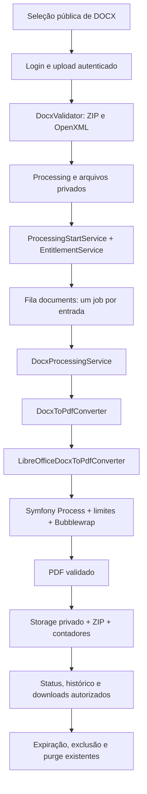

# DOCX → PDF — auditoria de implementação

16/10/2026. Implementação local no monorepo Feitoo, sem instalação de LibreOffice e sem deploy. A configuração operacional ainda precisa de homologação real em Linux antes de habilitar a ferramenta ao público.

## 1. Arquitetura adotada

Reutilizados Processing, ProcessingFile, Sanctum/owner middleware, endpoints de upload/start/status/files/result/pdf/delete, histórico, EntitlementService, assinatura Pro, TTL, purge, AnalyticsService, SeoService e geradores públicos. Não foram criados usuários, sistema de cobrança, tabela de processamentos, analytics ou renderer de DOCX paralelos.

O início de processamento foi extraído do executor fiscal para `ProcessingStartService`. O método anterior de `FiscalProcessingService::start` permanece como delegação compatível. A nova ferramenta usa serviço próprio; não passa pelo NfeParser/SafeXml e não grava resultados fiscais. A rotina de armazenamento/ZIP dos DANFEs foi extraída para `PdfResultService`, reutilizada por documentos e pelo wrapper DanfeResultService; DANFEs preservam nomes e LEIA-ME existentes.

## 2. Arquivos criados e alterados

Backend, relativos a `feitoo-api/`:

- Novos: `config/documents.php`; `app/Support/Documents/DocxValidator.php`, `DocumentException.php`; `app/Services/Documents/DocxToPdfConverter.php`, `LibreOfficeDocxToPdfConverter.php`, `ConversionProcessRunner.php`, `PdfOutputValidator.php`, `DocxProcessingService.php`; `app/Jobs/ProcessDocxToPdfJob.php`; `app/Services/ProcessingStartService.php`, `PdfResultService.php`.
- Integração: `.env.example`, `config/queue.php`, `routes/api.php`, `app/Enums/ProcessingTool.php`, `ProcessingFileError.php`, `app/Models/Processing.php`, `app/Providers/AppServiceProvider.php`, `app/Http/Controllers/ProcessingController.php`, `GoogleAuthController.php`, `app/Http/Requests/UploadProcessingFilesRequest.php`, `app/Http/Resources/ProcessingResource.php`, `app/Services/ProcessingService.php`, `FiscalProcessingService.php`, `DanfeResultService.php`, `EntitlementService.php`, `PurchaseService.php`.
- Testes: `tests/Feature/DocxToPdfTest.php`, `DocxConverterIntegrationTest.php`; seis DOCX sintéticos e gerador em `tests/Fixtures/Documents/`.
- Somente formatação para atender Pint completo: `app/Services/AnalyzerResultService.php`, `tests/Feature/XmlAnalyzerTest.php`.

Frontend, relativos a `feitoo-web/`:

- Novos: `src/app/features/processing/pages/docx-to-pdf.ts`, `.html`, `.scss`, `.spec.ts`; `scripts/browser-smoke.mjs`, `check-docx-browser.mjs`.
- Registro/navegação: `src/app/app.routes.ts`, `app.routes.server.ts`, `app.ts`, `app.html`; `features/processing/tools.ts`, `models/processing.ts`, `services/file-selection.service.ts` (serviço genérico) e `xml-selection.service.ts` (alias compatível); `features/auth/pages/auth-page.ts`, `services/auth.service.ts`; `features/account/pages/account-page.html`. `ProcessingConfig` é o contrato genérico, preservando o alias anterior `XmlToExcelConfig`.
- Catálogo: `features/public/home-tools.ts`, `home.ts`, `home.html`, `home.scss`, `home.spec.ts`.
- SEO/analytics: `src/app/core/public-pages.ts`, `seo.service.ts`, `tool-faqs.ts`, `public-launch.spec.ts`, `analytics.service.ts`, `analytics-events.spec.ts`; `scripts/generate-public-assets.mjs`, `public-assets.test.mjs`; `vercel.json`.
- Smoke geral atualizado para catálogo de seis ferramentas: `scripts/check-tool-browser.mjs`.

Documentação: este relatório e `docs/docx-to-pdf-production.md`. A alteração anterior de `docs/seo-audit.md` não foi reescrita nesta tarefa. A configuração pública gerada pelo build não é uma nova configuração permanente de desenvolvimento.

## 3. Migrations

**Nenhuma.** Tool/status/error_code são strings nas tabelas existentes. Novos valores foram registrados nos enums; a tabela database jobs já existe. Não há migração de usuário, pagamento ou histórico.

## 4. Endpoints usados

Nenhum endpoint paralelo:

| Método / rota                                | Uso DOCX                                               |
| -------------------------------------------- | ------------------------------------------------------ |
| GET /api/tools/docx_to_pdf/config            | Limites técnicos, Free/Pro e compra avulsa desativada  |
| POST /api/processings                        | Cria com tool=docx_to_pdf                              |
| POST /api/processings/{uuid}/files           | Upload multipart privado                               |
| POST /api/processings/{uuid}/start           | Reserva quota e despacha jobs após commit              |
| GET /api/processings/{uuid}                  | Status e contadores do lote                            |
| GET /api/processings/{uuid}/files            | Resultado individual, erros humanos, nomes autorizados |
| GET /api/processings/{uuid}/pdf/{input_uuid} | Download do PDF associado à entrada                    |
| GET /api/processings/{uuid}/result           | ZIP de PDFs, inclusive em lote parcialmente concluído  |
| DELETE /api/processings/{uuid}/files         | Exclusão de entradas, saídas e temporários             |
| GET /api/processings                         | Histórico da conta existente                           |
| GET /api/account/usage?tool=docx_to_pdf      | Plano e saldo por ferramenta                           |

Somente configuração e página da ferramenta são públicas. Demais endpoints usam auth:sanctum e owner middleware. Downloads rechecados sob lock: usuário, processamento, tipo de ferramenta, estado completed, vínculo do input/output e expiração; outro usuário recebe 404, não a existência do documento.

## 5. Fluxo completo

Página pública → seleção/drag-drop → login quando necessário → create → upload privado → validação real por arquivo → start com reserva de quota → fila específica → cópia temporária com integridade verificada → conversão isolada → validação de PDF → cleanup → publicação sob lock e rechecagem de TTL → resultado, PDF/ZIP e histórico → expiração/purge.

Somente DOCX é aceito no contrato HTTP. Erros de extensão/tamanho/envelope retornam 422. Conteúdo inválido dentro de um arquivo `.docx` é representado por entrada failed com código humano; o arquivo inseguro não é armazenado nem entregue ao motor. Assim um arquivo inválido não descarta documentos válidos vizinhos. O job repete a validação para proteger o limite de confiança do conversor.

## 6. Validação DOCX

Validador específico de documentos, separado de SafeXml:

- Extensão DOCX, MIME detectado compatível, assinatura ZIP, tamanho não vazio e limite por arquivo.
- ZipArchive CHECKCONS/RDONLY; componentes `[Content_Types].xml`, `_rels/.rels`, `word/document.xml`; namespaces, content type Word não macro e officeDocument relationship.
- Todos os bytes de todas as entradas são lidos de modo limitado e têm tamanho/CRC comparados. XMLs devem ser bem formados; DTD, entidades e acesso de rede são recusados, sem expansão de entidades.
- Rejeição de macros/ActiveX/OLE, binários ativos, objetos incorporados, campos dinâmicos e links externos ativos. Hyperlinks HTTP/HTTPS/mailto são permitidos como links inertes; caminhos/URIs suspeitos são recusados.
- Nomes ZIP absolutos, com traversal, barras Windows, drives, controles, duplicatas ignorando caixa, symlinks, criptografia e algoritmos de compressão não permitidos são recusados.

Nenhum ZIP é extraído no filesystem pela aplicação. A validação não é garantia de ausência de vulnerabilidades no parser externo: isolamento de produção é obrigatório e o motor deve permanecer corrigido.

## 7. Proteção ZIP bomb

Defaults: 2.048 entradas, 80 MiB descompactados por documento, relação de compressão máxima 100:1 por entrada e 10 MiB por parte XML. Primeiro é inspecionado o diretório inteiro; só depois começam as leituras limitadas em chunks de 64 KiB, com tamanho real/CRC e orçamento de tempo. Validação não acumula todos os conteúdos do ZIP em memória. Lote técnico máximo 20 documentos/40 MiB de entrada; PDF máximo 25 MiB por arquivo/80 MiB somados no lote, limitando também a agregação em ZIP.

## 8. LibreOffice seguro

Interface `DocxToPdfConverter` com implementação encapsulada. Symfony Process recebe **array de argumentos**, nunca shell interpolado. Caminhos, input.docx, output e profile são internos; nome original só existe como metadata segura. Execução headless, sem wizard/recovery, macros/active content/OLE desabilitados e atualização de links em Never.

Produção usa Bubblewrap/prlimit: namespaces de rede/mount/user separados, capabilities removidas, runtime readonly, segredos/diretórios da aplicação não montados e workspace único. Não há acesso aos arquivos dos outros processamentos. O modo sem sandbox é permitido apenas para desenvolvimento/testing e é recusado em produção. Sem motor/sandbox, erro humano de indisponibilidade. stdout/stderr são descartados e nunca apresentados ou logados.

## 9. Timeout e queue

Uma entrada por job, não uma conversão no HTTP nem um job de 20 × 60 s. Parede: 60 s/configurável até 120; CPU: timeout + 2; job: timeout + 20; lock por arquivo: timeout do job + 10; retry_after=180 na conexão documents. Workers XML preservam o timeout existente. Exceções de timeout e indisponibilidade produzem códigos próprios. Exceções persistidas de job são sanitizadas.

## 10. Cleanup

Workspace exclusivo removido em finally em sucesso/falha/timeout normal. Delete/TTL durante conversão é rechecado antes da publicação e não pode recriar saídas. Mortes abruptas podem impedir finally; prefixos document-temporary e pdf-temporary são conhecidos pelo purge existente e expiram com o Processing. Não se promete cleanup imediato após SIGKILL.

## 11. Storage e validação do resultado

Mesmo disk privado de processamentos; temporários no disk local privado. Entradas usam UUID.docx; PDFs usam UUID de entrada + .pdf; nome amigável é higienizado e salvo apenas em metadata. ZIP usa prefixo UUID por PDF, evitando colisões entre nomes iguais. Nenhum storage:link, arquivo em public ou rota pública de download foi criado.

PDF precisa existir, não ser symlink, ter tamanho permitido, assinatura/versionamento PDF, startxref e EOF. Exit code zero sozinho não basta. É uma verificação estrutural básica, não um validador integral de conformidade PDF. O PDF validado é publicado depois do cleanup, registrando tamanho/checksum. Código não registra texto, conteúdo, nomes originais ou stderr em logs; usa IDs/códigos técnicos.

## 12. Processing e resultado parcial

Tool interno `docx_to_pdf`. Estados existentes mantidos: pending/uploading/queued/processing/completed/failed/expired. Não foi criado status incompatível: **partial = completed com successful_files_count > 0 e failed_files_count > 0**, padrão atual. Falha total = failed. Inputs têm resultados individuais; saídas não dependem de dados fiscais. Job duplicado não reconverte entradas concluídas nem duplica quota/saídas.

## 13. Limites e entitlements

EntitlementService calcula o plano existente e usa overrides da configuração central para DOCX, mantendo locks/reservas por usuário e dia por ferramenta. Free: **3/lote, 6/dia**. Pro: **20/lote, 100/dia**, usando a assinatura atual e TTL Pro atual. Reservados todos os arquivos aceitos no start; apenas conversões concluídas são contabilizadas ao terminar. Exclusão ativa libera a reserva. Quota de XML não é consumida por DOCX.

Compra avulsa desativada no backend/config/UI, seguindo o padrão já aplicado a outras ferramentas. Não foram criados produtos/preços Stripe; pacotes XML não são vendidos como crédito DOCX.

## 14. Histórico e autenticação

Histórico atual identifica DOCX para PDF, quantidade de documentos, data e estado, com download do ZIP, Ver PDFs e exclusão. Não inclui texto extraído ou nome/conteúdo do documento no resumo. Página restaura o Processing autorizado pela query `?processing=uuid`; canonical e analytics removem query. Seleção em memória usa o serviço existente, sem duplicar infraestrutura.

Login/cadastro por e-mail retorna à ferramenta e mantém a seleção na mesma SPA. Allowlists de retorno Google foram estendidas no frontend e backend. **O redirecionamento completo do Google perde File em memória, como no fluxo existente:** a interface informa que é preciso selecionar novamente. Não se adicionou persistência de documentos em localStorage/IndexedDB nem armazenamento permanente no navegador.

## 15. Analytics

AnalyticsService existente reconhece `docx_to_pdf`; eventos tool_view, processing_started e processing_completed, com resultado success/partial e contagem/plano permitidos. Consentimento continua obrigatório e deduplicação usa o mecanismo existente. Allowlist descarta nomes, textos, e-mail e metadata interna, coberto por teste real do serviço. Nenhum analytics paralelo.

## 16. SEO e conteúdo

- Rota: `/docx-para-pdf`.
- Title: **DOCX para PDF Online | Converter Word em PDF | Feitoo**.
- Description: **Converta arquivos DOCX do Word para PDF online. Envie seus documentos e baixe os PDFs prontos em poucos passos.**
- H1: **Converter DOCX para PDF online**.
- Canonical: `https://feitoo.com.br/docx-para-pdf`.
- WebApplication, BreadcrumbList e FAQPage no mesmo JSON-LD existente, FAQ visível compartilhada; nome de aplicação corresponde ao H1. OG atual preservada; sem reviews/ratings/offers fictícios.
- Conteúdo explica uso, preservação e limitações, lote, privacidade, diferença DOC/DOCX e FAQ. Links contextuais para segurança/planos. Nenhum link artificial inserido nas páginas XML.
- Home tem seis ferramentas, com grupos leves XML e documentos fiscais / Documentos e card Converter DOCX. Rodapé tem grupo Documentos.

## 17. Sitemap/prerender

Nova rota em public-pages, sitemap, prerender e regras 308 para barra final/index.html. Build gera **13 páginas públicas + 404 = 14 rotas prerenderizadas**. Gerador valida HTML útil, H1/metadados/canonical, OG, schema/FAQ e links de segurança/planos. Shell privado noindex permanece. Não houve deploy, portanto HTML/HTTP/redirects da nova rota ainda não foram conferidos na Vercel nem sua indexação no Search Console.

## 18. Testes backend

Suite completa: **286 passaram, 1 pulado, 2.721 assertions**. O pulado é apenas o teste opcional com LibreOffice real, ausente localmente. Testes novos cobrem fixtures válidas; formatos proibidos; falsificação/corrupção; ZIP inseguro, macro, objeto e link externo; expansão/quantidade/MIME/tamanho; upload privado; fila; sucesso/parcial/falha total; checksum; saída inválida; timeout real do subprocesso PHP; erros humanos; cleanup; idempotência; Free/Pro/diário/TTL; autorização/outro usuário; expiração/purge e exclusão durante conversão. API/fluxo usa fake de converter, não exige LibreOffice na suite normal.

Pint executado sobre alterações e verificação completa; duas pendências preexistentes de formatação do Analisador foram normalizadas. git diff --check verificado. Banco da suite é SQLite em memória, conforme phpunit.xml; não foram executadas migrações/testes destrutivos no MySQL de produção. Locks/concorrência devem ser exercitados também em homologação MySQL.

## 19. Testes frontend e smokes

- **189 testes passaram, 19 arquivos**, incluindo renderização, seleção, formatos, drag/drop, múltiplos arquivos, remoção, limites, login/retorno, upload/start/polling, sucesso/parcial/falha, PDF/ZIP, exclusão/expiração, restauração do histórico, analytics e SEO.
- **5 testes públicos passaram**: sitemap, rotas/redirects, staging, shell privado e assets.
- Prettier aplicado aos arquivos alterados; git diff --check verificado.
- Smoke geral existente passou: XML para Excel/Produtos, login/cadastro, perfil/senha/conta, histórico/download/exclusão e responsividade.
- Smoke Organizador existente passou em desktop/mobile, upload, resultado parcial e ZIP.
- Novo smoke DOCX passou: drag/drop, rejeição de formato, polling, 2/3 convertidos, PDF individual, ZIP e exclusão. Layouts públicos 320/375/390/768/1440 px e parcial 320/390/1440 px sem overflow; zero erros de runtime.
- Relatórios/capturas locais em `feitoo-web/dist/validation/`, incluindo `docx-browser-report.json`, `browser-report.json` e `account-browser-report.json`. São APIs sintéticas, não integração real com Google/Stripe/LibreOffice.

## 20. Build

Build de produção aprovado com 14 rotas estáticas. Inicial: **365,67 kB**, transferência estimada **103,58 kB**; chunk DOCX lazy **18,94 kB**, transferência **5,99 kB**. Permanece aviso anterior de SCSS do XML (5,56 kB > orçamento de aviso de 4 kB), sem falha de build. Não foram medidos Core Web Vitals de campo nesta tarefa.

## 21–22. Operação e comandos de produção

[docx-to-pdf-production.md](docx-to-pdf-production.md) contém dependências/versões, verificação `which soffice`/`soffice --version`, env Linux/Windows, sandbox/permissões/fontes, worker específico, timeouts, cleanup, teste real opcional, checklist de deploy e pós-deploy. **São instruções para revisão; nada foi executado no VPS.** Nenhuma instalação ou mudança em Evolution API, Nginx, Docker ou serviços compartilhados.

## 23. Riscos conhecidos e pendências

1. **Homologação real obrigatória:** LibreOffice/Bubblewrap não disponíveis/testados neste Windows; executar teste opcional em Linux, comparar visualmente as seis fixtures e registrar fontes, versão, memória, tempo e restrições de namespaces antes de deploy.
2. O motor pode ter diferenças de layout e vulnerabilidades próprias; isolamento e atualizações continuam necessários. Limites de processo não substituem medição de recursos agregados no VPS compartilhado. Começar com um worker.
3. SIGKILL/queda pode deixar temporários até TTL/purge. Verificar scheduler e failed_jobs; não aumentar timeout/retry_after global.
4. A seleção precisa ser refeita depois de Google/full reload; e-mail preserva a seleção na SPA, sem persistir conteúdo no navegador.
5. Validação é deliberadamente conservadora: documentos com recursos ativos/avançados são recusados. MIME/arquivo inválido não é encaminhado ao motor.
6. Verificar deploy backend antes do frontend, conexão documents, MySQL/locks, autorização/TTL e regras da Vercel. Não houve confirmação em produção, Search Console ou Google OAuth real.

## 24. Fora do MVP

DOC/DOCM e outros formatos; editor de Word; preview visual de DOCX/PDF na página; renderer próprio; OCR/IA; comparação; assinatura; armazenamento permanente; persistência de arquivos selecionados entre redirecionamentos completos; compra avulsa DOCX; instalação automática de fontes/motor; alterações de Stripe/infraestrutura e deploy. ZIP seguro de resultados foi incluído, reutilizando a infraestrutura de PDFs existente.

**Entrega parada para revisão antes de qualquer deploy.** O código e os testes com fake estão prontos; homologação do motor e do isolamento reais permanece uma condição operacional de publicação.
