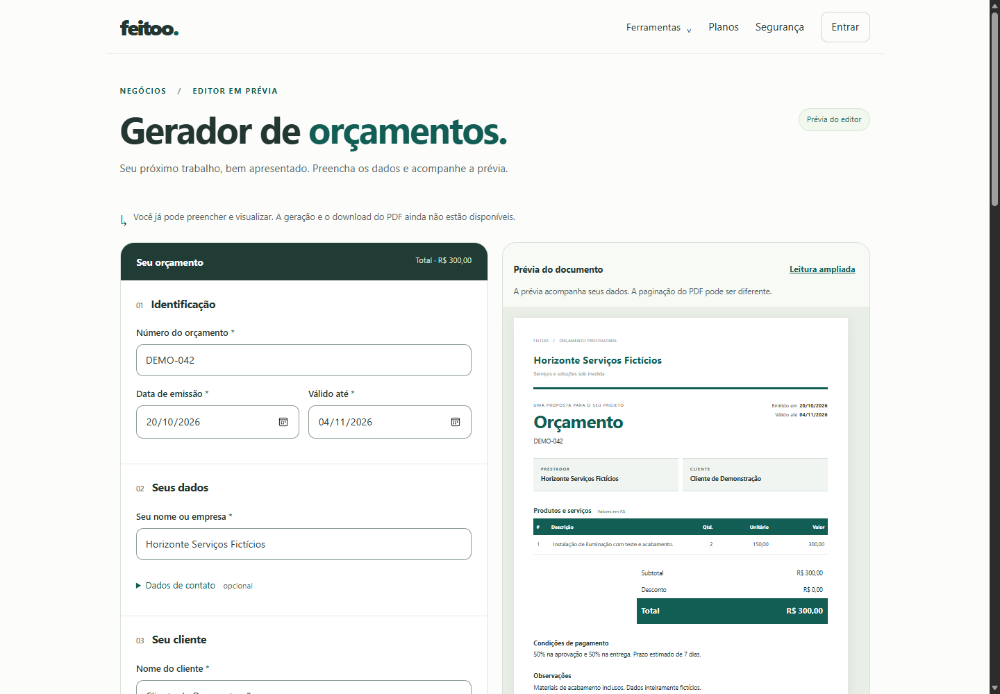
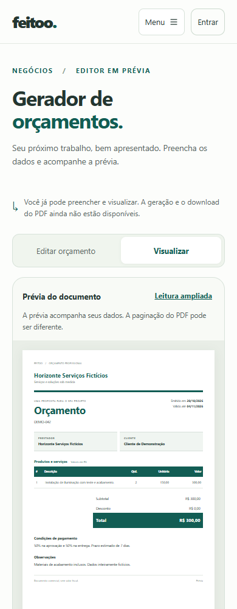

# Gerador de Orçamentos — Fase 2: editor visual Angular

**Data:** 20/10/2026. **Resultado:** editor e prévia implementados em `/gerador-de-orcamentos`, exclusivamente no frontend, com dados apenas em memória.

O botão **Gerar orçamento em PDF** permanece desabilitado e explica que geração/download ainda não estão disponíveis. Não há PDF alternativo no navegador, API de orçamento, login associado ao formulário, checkout, histórico, créditos ou persistência de rascunho. O motor Blade/Dompdf e todo o backend da Fase 1 foram preservados.

## 1. Componentes criados

Feature em `feitoo-web/src/app/features/quotations/`, com componentes standalone e Reactive Forms tipados:

| Arquivo/grupo                                 | Responsabilidade                                                                                    |
| --------------------------------------------- | --------------------------------------------------------------------------------------------------- |
| `pages/quotation-page.{ts,html,scss}`         | Página pública, formulário, estado em memória, ações, layout desktop/mobile e ciclo de vida do logo |
| `pages/quotation-form.scss`                   | Estilos comuns dos campos e seções, restritos a `.quotation-app`, inclusive nos componentes filhos  |
| `components/quotation-party.ts`               | Grupo tipado reutilizado para prestador/cliente; dados adicionais opcionais                         |
| `components/quotation-items.{ts,html,scss}`   | `FormArray`, cartões de itens, inclusão/exclusão e totais por linha                                 |
| `components/quotation-preview.{ts,html,scss}` | Documento em prévia, modelos, textos integrais e leitura ampliada                                   |
| `components/quotation-template-picker.ts`     | Seleção por rádios nativos de Moderno/Clássico                                                      |
| `components/quotation-money.ts`               | ControlValueAccessor de reais para centavos, sem biblioteca de máscara                              |
| `models/quotation.ts`                         | Tipos do editor, formulários, cálculo e futuro DTO canônico                                         |
| `services/quotation-calculator.ts`            | Parsing brasileiro, aritmética por BigInt, formatação e mapeamento para o contrato                  |
| `services/quotation-form.ts`                  | Construção dos formulários e validação local                                                        |
| `services/quotation-logo.ts`                  | Inspeção binária, decodificação, normalização local e criação de object URL                         |
| Três arquivos `.spec.ts`                      | Cálculo, formulário/componentes e segurança básica do logo                                          |

Também foram criados `scripts/quotations-public.test.mjs` e `scripts/check-quotation-browser.mjs`. Integrações em arquivos preexistentes ficaram limitadas a rotas Angular, rotas de prerender, reconhecimento/metadados da página e configuração Vercel. Não houve instalação de pacote ou alteração do `package.json`/lock.

**Design system real:** o código atual usa tokens CSS, classes próprias como `.btn`/`.form-control` e ícones locais; não carrega os pacotes Bootstrap/Bootstrap Icons informados no contexto. A implementação reutiliza essa linguagem visual e as classes já existentes, sem importar outro framework/CSS global que possa alterar as seis ferramentas atuais. Não foi reutilizado o uploader XML como estrutura do editor.

## 2. Estrutura da página

A página começa com a identificação da ferramenta, aviso de que o PDF ainda está indisponível e o próprio editor, sem landing intermediária ou painel administrativo.

O formulário organiza sete seções: identificação; prestador; cliente; produtos/serviços; valores/desconto; condições/observações; aparência. Campos de contato ficam em grupos expansíveis opcionais. Cada item possui descrição, quantidade, valor unitário e total calculado. O formulário inicia com um item, impede a exclusão do último e limita a inclusão a 100.

O modelo inicial é **Moderno**. Trocar para Clássico altera somente a apresentação; todos os dados e valores permanecem. Um resumo do total acompanha o cabeçalho fixo do editor. O bloco completo de subtotal/desconto/total permanece na seção de valores.

“Conferir dados da prévia” valida localmente, apresenta erros e posiciona o foco no primeiro campo inválido, abrindo o grupo opcional se necessário. Não faz requisição nem gera arquivo. “Gerar orçamento em PDF” é um controle nativamente desabilitado, associado ao texto explicativo.

Não foram criados CRM, cadastros persistentes de clientes/produtos, estoque, dashboard ou módulos administrativos.

## 3. Contrato de dados e privacidade

O formulário usa grupos tipados de prestador/cliente e `FormArray<ItemForm>`. Signals derivados de `valueChanges`/`statusChanges` alimentam cálculo, estado e prévia; o formulário continua sendo a fonte editável. Não foi usado NgRx.

O mapeamento futuro produz o schema da Fase 1:

```json
{
  "schema_version": 1,
  "currency": "BRL",
  "number": "ORC-001",
  "issue_date": "2026-10-20",
  "valid_until": "2026-11-04",
  "issuer": {
    "name": "Prestador fictício",
    "document": "",
    "email": "",
    "phone": "",
    "address": ""
  },
  "customer": {
    "name": "Cliente fictício",
    "document": "",
    "email": "",
    "phone": "",
    "address": ""
  },
  "items": [
    {
      "description": "Serviço fictício",
      "quantity": "2.5000",
      "unit_price_cents": 15000
    }
  ],
  "discount": { "type": "percent", "value": "10.00" },
  "conditions": "",
  "notes": "",
  "template_id": "modern"
}
```

`validatedPayload()` só disponibiliza esse mapeamento quando o formulário e o cálculo local estiverem válidos. Não há transporte, autosave ou chamada automática. Totais calculados e logo ficam separados do DTO de entrada.

Limites alinhados ao backend: 100 itens; descrição de até 1.000 caracteres; condições/notas de até 4.000 cada; identificação até 60; nomes até 160; CPF/CNPJ até 30; telefone até 40; endereço até 400; e-mail até 254. Identificação e contatos são de uma linha. Nomes de ambas as partes, identificação, datas e descrição são obrigatórios para concluir a conferência. CPF/CNPJ, contatos e endereço são opcionais.

Datas são civis `YYYY-MM-DD`, verificadas contra datas reais. A validade não pode anteceder a emissão. No navegador, emissão recebe a data atual em São Paulo e validade inicial de mais 15 dias; o usuário pode alterá-las. Os defaults só são aplicados após a renderização, para não inserir data dinâmica no prerender.

Os dados permanecem exclusivamente em memória. A feature não injeta HttpClient, serviços de autenticação ou analytics e não usa IndexedDB, localStorage ou sessionStorage. O conteúdo digitado não entra em URLs, metadados SEO ou eventos de medição. A página informa que atualizar/sair perde o preenchimento.

O shell existente do Feitoo continua consultando a sessão por `GET /api/me`; essa chamada preexistente não foi alterada nem integrada ao editor. O teste do navegador interceptou a sessão localmente e confirmou **nenhum outro endpoint de API** durante edição, cálculo, troca de modelo, logo e conferência. Nenhum request foi feito à produção pelo teste.

## 4. Cálculos e máscara de moeda

A aritmética financeira usa **BigInt com escala inteira**, sem multiplicação monetária por ponto flutuante:

1. Quantidade é convertida para escala 10.000; aceita vírgula ou ponto decimal, até quatro casas e valor positivo até 1 milhão.
2. Valor unitário é armazenado como inteiro em centavos, entre zero e 1.000.000.000 centavos (R$ 10 milhões).
3. Cada linha é calculada por `(quantidadeEscalada × centavos + 5000) / 10000`, com divisão inteira: HALF_UP para valores não negativos.
4. Subtotal é a soma das linhas já arredondadas, com teto de 100.000.000.000 centavos (R$ 1 bilhão).
5. Percentual usa duas casas: `(subtotal × percentualEscalado + 5000) / 10000`. Desconto fixo usa centavos.
6. Desconto acima do subtotal ou entrada inválida deixa o total indisponível (`—`), com explicação; nunca produz valor negativo ou converte erro silenciosamente em zero.

Conversões de volta para `number` só acontecem com inteiros dentro dos limites seguros. A formatação BRL também utiliza divisão/módulo inteiro.

Exemplos da Fase 1 usados como testes:

- `0,5 × 101 centavos → 51 centavos` em cada linha.
- Duas linhas de 51 e uma de `0,0001 × 5000 → 1` somam 103. Desconto de 50% resulta em desconto 52 e total 51.
- `12,3456 × 2750 → 33950`; outra linha de 51 resulta em subtotal 34001. Desconto fixo 1000 resulta em 33001.
- Itens gratuitos e desconto integral são permitidos; excesso de linha/subtotal e percentual acima de 100 são recusados.

A máscara de moeda preserva o cursor enquanto a pessoa digita e formata no blur: `1.234,56` corresponde a `123456` centavos. Aceita colagem com `R$`, rejeita expoentes, negativos, grupos malformados e mais de duas casas. Não trata ponto como separador decimal de reais; para centavos, usar vírgula. Valores inválidos permanecem visíveis no input para correção, mas o modelo recebe `null` e bloqueia a conferência válida.

Na integração futura o backend continua sendo a autoridade: o cálculo local fornece a experiência de edição, não autorização para emitir ou consumir saldo.

## 5. Prévia e modelos

O componente de prévia representa cabeçalho, logo, identificação/datas, prestador, cliente, tabela de itens, subtotal/desconto/total, condições, observações e rodapé. Clássico usa apresentação discreta; Moderno segue verde, branco e cinza, com total destacado, próximo da estrutura Blade aprovada.

A folha usa proporção A4 mínima e escala tipográfica relativa ao espaço disponível. Ela pode crescer verticalmente para representar conteúdo extenso; não simula páginas definitivas. Condições, observações e descrições preservam quebras e não usam ellipsis, limite de amostra ou corte silencioso. Também foram testados 100 itens na prévia.

O aviso de que a paginação pode diferir do PDF aparece junto ao documento. Não há contador fictício de páginas, botão de impressão convertido em download nem PDF criado no navegador.

“Leitura ampliada” permite ler em fonte maior e reorganiza as partes em uma coluna, mantendo a página sem overflow horizontal. “Ajustar à tela” retorna à visão de folha. A mudança de apresentação não modifica o contrato ou os dados.

O conteúdo do usuário é interpolado pelo Angular como texto. Não há `innerHTML`, `bypassSecurityTrustHtml`, CSS livre ou biblioteca de edição. Uma tentativa de inserir `<script>` foi exibida literalmente e não executou código no teste do navegador.

## 6. Responsividade

| Largura           | Comportamento verificado                                                    |
| ----------------- | --------------------------------------------------------------------------- |
| 320, 375 e 390 px | Uma coluna, cards de itens, campos de toque e alternância Editar/Visualizar |
| 768 px            | Mesma alternância em coluna única, aproveitando a largura adicional         |
| 1024 e 1440 px    | Editor à esquerda e prévia à direita, sem interseção dos painéis            |

No desktop, a prévia permanece fixa durante a edição e tem rolagem própria para documentos longos. O total acompanha o cabeçalho do editor quando a pessoa chega às seções inferiores. No mobile, os botões de modo ficam acessíveis durante a rolagem; os painéis preservam o formulário ao alternar.

Foram executadas **17 verificações de layout**: os seis tamanhos em Editar/Visualizar, estados de leitura ampliada e estados com 100 itens. Nenhum caso apresentou overflow horizontal da página ou sobreposição entre editor e prévia. O script também confirmou o comportamento fixo do total no desktop.

As medidas foram feitas no Edge headless em Windows, com emulação de viewport/mobile. Não equivalem a teste em iPhone/Android físico ou homologação em Safari.

## 7. Acessibilidade

- Labels associados aos inputs, grupos de partes com `fieldset/legend`, seções com títulos e tabelas com cabeçalhos/caption.
- Mensagens de erro vinculadas por `aria-describedby` e estado `aria-invalid`; validação explícita abre contatos opcionais e move o foco ao primeiro erro.
- Seleção de modelo com rádios nativos e foco visível no cartão; controles de modo com `aria-pressed` e `aria-controls`.
- Inclusão/remoção de itens por botões com nome acessível; após a ação, o foco retorna a uma descrição apropriada. Exclusão do último item e inclusão acima de 100 ficam desabilitadas.
- Resumo de conferência e falhas usam mensagens de status. A folha inteira não é uma região live a ser relida a cada tecla.
- Inputs e botões de ação com alvo mínimo de aproximadamente 44–48 px. A checagem real não encontrou controles visíveis sem rótulo ou alvos ativos abaixo do mínimo adotado; rádios usam o cartão clicável.
- Foco por teclado, campos confortáveis em mobile, escopo de estilos próprio e opção de leitura ampliada para a folha reduzida.
- Botão PDF nativamente desabilitado e explicação disponível, sem aparência de download concluído.

São verificações básicas de implementação e navegador; não foi realizada certificação WCAG nem teste completo com leitor de tela/dispositivo físico.

## 8. SEO, disponibilidade e prerender

Rota pública lazy em `app.routes.ts`, sem guard de login, e prerender em `app.routes.server.ts`. A página é acessível diretamente para revisão, mas foi mantida **fora do catálogo, footer de ferramentas e sitemap** até a integração efetiva do PDF. As seis ferramentas existentes continuam no catálogo.

Metadados solicitados:

- Title: **Gerador de Orçamentos Online Grátis | Feitoo**
- Description: **Crie orçamentos profissionais para serviços e produtos. Adicione clientes, valores, descontos e personalize o modelo do documento.**

`previewPages` separa metadados dessa página dos registros indexáveis existentes. Robots HTML e header Vercel aplicam `noindex,follow`; canonical aponta para a rota limpa. O schema é somente **WebPage**, sem WebApplication/FAQ/Offers que anunciem geração ou planos como disponíveis. Não foram criados textos comerciais de checkout ou FAQ de funcionalidades futuras.

`safePage` reconhece a rota e remove query/hash antes de metadados e do page view global já existente. Vercel normaliza `/gerador-de-orcamentos/` e `/gerador-de-orcamentos/index.html` para a URL limpa com 308, antes do filesystem; o comportamento de 404 real permanece.

O build gerou **15 rotas estáticas**: as 13 páginas indexáveis atuais, a prévia nova e 404. O HTML inicial contém editor seguro, Moderno e campos pessoais vazios; não usa File/Image/Canvas/URL de logo nem relógio do navegador para executar o prerender. Os recursos de logo só são acionados por seleção local após hidratação.

O build de produção atualiza o arquivo de configuração gerada de origem; depois da validação, a origem original do workspace foi restaurada, preservando o estado anterior desse arquivo. Os artefatos em `dist` permanecem os que foram efetivamente testados.

## 9. Testes e resultados

| Verificação executada             | Resultado final                                                                                                                                        |
| --------------------------------- | ------------------------------------------------------------------------------------------------------------------------------------------------------ |
| Novos testes Angular              | **57 aprovados**, em 3 arquivos                                                                                                                        |
| Suíte Angular completa            | **268 aprovados**, em 23 arquivos, zero falhas                                                                                                         |
| Testes públicos/SEO               | **15 aprovados**, incluindo nova página e páginas das seis ferramentas                                                                                 |
| Navegador: editor                 | **17 verificações responsivas**, cálculo real, máscara, erro/foco, modelos, PNG/JPEG, rejeição de imagem falsa, 100 itens, texto extenso e privacidade |
| Navegador: ferramentas existentes | **6 ferramentas, 96 verificações de layout e 8 downloads fictícios**, zero erros de execução                                                           |
| Build de produção/prerender       | Aprovado; feature lazy de aproximadamente **51,18 kB**, transferência estimada **13,19 kB**                                                            |
| Prettier                          | Aprovado em todos os arquivos modificados/criados desta fase                                                                                           |
| `git diff --check`                | Aprovado; Git somente informou conversões LF/CRLF previstas no ambiente                                                                                |

Testes novos cobrem criação/validação do formulário, datas reais, quantidade fracionária, HALF_UP, desconto fixo/percentual, total/subtotal, teto monetário, zero, tipos inválidos, parsing/blur da moeda, inclusão/exclusão, preservação de dados na troca de modelo, atualização da prévia, HTML literal, logo e liberação de URLs, resposta assíncrona após remoção e associações básicas de acessibilidade.

O teste de navegador usou servidor local, arquivos do build e dados fictícios. Confirmou zero gravações pessoais em localStorage/sessionStorage, zero object URLs remanescentes após as ações de logo, zero chamadas fiscais/checkout e zero exceções de execução. A única chamada de API observada foi a consulta de sessão preexistente do shell, interceptada como 401 local.

Comandos principais, executados em `feitoo-web/`:

```powershell
npm.cmd test -- --watch=false
node --test scripts/public-assets.test.mjs scripts/home-docx-seo.test.mjs scripts/tools-experience-seo.test.mjs scripts/quotations-public.test.mjs
$env:FEITOO_BUILD_ENV='production'
npm.cmd run build
node scripts/check-quotation-browser.mjs
node scripts/check-tools-experience-browser.mjs
npm.cmd exec prettier -- --check src/app/features/quotations src/app/app.routes.ts src/app/app.routes.server.ts src/app/core/public-pages.ts src/app/core/seo.service.ts vercel.json scripts/quotations-public.test.mjs scripts/check-quotation-browser.mjs
git diff --check
```

O navegador precisou de execução local fora do sandbox para funcionar com CDP; o teste não acessou produção. Os avisos remanescentes do build são de tamanho de estilos em `app.scss`, `home.scss` e `tool-experience.scss`, arquivos preexistentes que não foram alterados nesta fase. **Os estilos novos não excedem o orçamento de warning.**

Não foram executadas ou modificadas suítes backend, migrations, testes de pagamento ou jobs. Não houve instalação de dependências, deploy, commit/push, alteração em Stripe, VPS ou workers.

## 10. Limitações desta fase

1. O editor é uma prévia funcional local. Não emite, baixa, compartilha ou salva orçamento definitivo.
2. Recarregar/sair perde os dados; não existe IndexedDB, rascunho remoto ou recuperação por login.
3. Paginação, fontes, glifos e limite final de páginas do Dompdf permanecem sujeitos ao backend. A prévia não replica o motor de layout do PDF.
4. O logo local é limitado a 2 MiB e 4 milhões de pixels, com leitura de assinatura/dimensões antes da decodificação, recodificação PNG e redução a 1.200 px. A integração futura deve validar novamente no servidor; nenhum resultado do navegador deve ser considerado confiável pela API.
5. O e-mail usa validação do Angular no frontend; o backend mantém a validação RFC da Fase 1 como autoridade.
6. A revisão de acessibilidade e responsividade foi básica em Edge, sem certificação ou homologação em todos os navegadores/dispositivos.
7. Free diário, pacote de cinco créditos e Pro não estão conectados ao editor. Nenhuma mensagem sugere consumo ou pagamento realizado.

## 11. Screenshots

Imagens geradas com dados inteiramente fictícios, copiadas para `docs/images` para revisão. Não fazem parte dos assets publicados da aplicação.

Desktop, 1440 px:



Mobile, editor em 390 px:


Mobile, prévia ajustada à tela:



Mobile, leitura ampliada:


Relatórios detalhados e screenshots reproduzíveis ficam em `feitoo-web/dist/validation/quotations/`; a regressão das ferramentas existentes fica em `dist/validation/tools-experience/`. Esses artefatos de execução são ignorados pelo Git.

## 12. Preparação para a Fase 3

O formulário, o DTO canônico e os vetores de cálculo estão preparados para uma integração posterior, sem acoplar a feature aos serviços fiscais. A próxima fase deve ser autorizada separadamente e definir persistência temporária, importação do rascunho após login, ownership, validação backend, fila/Processing comercial e download privado.

O contrato comercial permanece: **Free de 1 geração bem-sucedida por dia em `America/Sao_Paulo`**, avulso de R$ 9,90 por cinco créditos reutilizáveis e proposta inicial Pro de 100 por período da assinatura. Reservas simultâneas entram no limite; falhas técnicas não consomem; re-download do mesmo resultado não debita novamente. Nenhuma dessas políticas foi implementada nesta fase.

Quando a geração real estiver homologada, revisar a liberação do botão PDF, os estados de espera/erro/sucesso, a descoberta pública, robots, sitemap e schema. Não habilitar indexação ou ofertas de emissão antes de a experiência existir de ponta a ponta.

**Fase 2 concluída. A Fase 3 não foi iniciada; aguardando autorização do usuário.**
