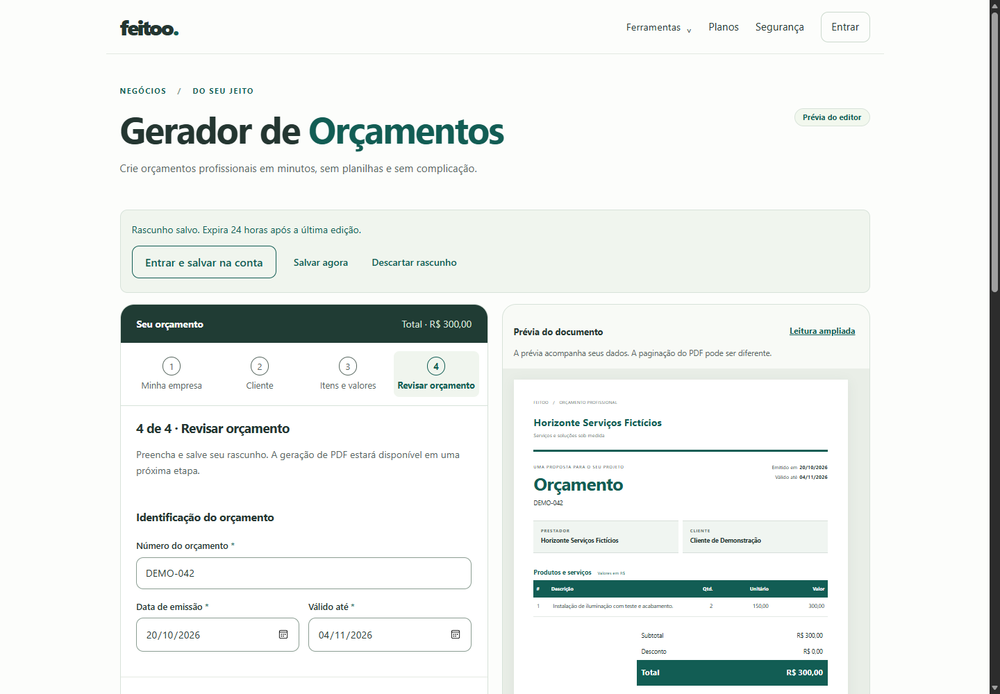
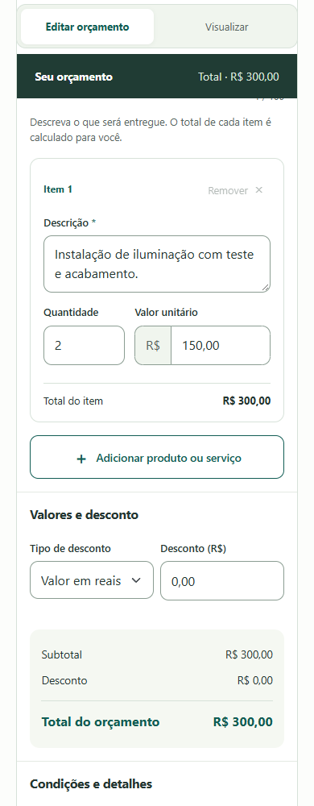

# Gerador de Orçamentos — Fase 3: rascunhos, autenticação, persistência segura e Bootstrap 5

**Data:** 22/10/2026. **Resultado:** persistência temporária local e autenticada implementada e validada localmente. PDF permanece desabilitado. Esta entrega não autoriza publicação nem início da Fase 4.

**Revisão em 28/10/2026:** Bootstrap 5.3.8 integrado com escopo no gerador e persistência revalidada. O checkout já continha a implementação de rascunhos e código das Fases 4–6; esse código foi preservado. Emissão e novas compras de orçamentos ficam desabilitadas por padrão, e a rota volta ao modo de revisão sem catálogo/indexação, conforme o escopo solicitado. As seções 1–13 registram a arquitetura e a validação original de 22/10; as seções 14–19 documentam as alterações e as evidências desta revisão, que prevalecem sobre os números históricos.

## 1. Arquitetura implementada

Os três documentos anteriores, o status Git e os diffs foram inspecionados antes das alterações. A raiz e o repositório frontend já continham trabalho não commitado das fases anteriores e de monetização; esse trabalho foi preservado. Nenhum AGENTS.md foi encontrado na árvore pesquisada.

O editor continua público em `/gerador-de-orcamentos`, standalone Angular 21, com formulário e prévia locais. Não depende de resposta bem-sucedida de `/api/me` para permitir edição anônima. Cópias associadas a uma conta só são restauradas depois de confirmar essa identidade.

Componentes novos em `feitoo-web/src/app/features/quotations/services/`:

- `quotation-local.store.ts`: IndexedDB, transações, identificação opaca da aba, expiração e comparação de revisão local.
- `quotation-draft-api.service.ts`: API comercial, CSRF, cabeçalhos de consistência de conta e logotipo separado do JSON.
- `quotation-draft.coordinator.ts`: debounce de 450 ms, fila serial de salvamento, restauração, importação, conflitos, erros e ciclo de vida.

O Laravel ganhou `QuotationDraft`, `QuotationDraftController`, `QuotationDraftPayload`, `QuotationDraftAccountContext` e `PurgeQuotationDrafts`. Nenhum deles usa os endpoints fiscais, filas, renderer PDF, compras, entitlements, Stripe ou metadata de Processing.

## 2. Migration e schema

Migration aditiva: `feitoo-api/database/migrations/2026_10_22_000001_create_quotation_drafts_table.php`.

Foi revisado o schema versionado existente, incluindo o `users.id` BIGINT e as convenções de UUID/timestamps. A migration foi efetivamente aplicada somente ao SQLite em memória dos testes. O schema instalado em MySQL operacional não foi acessado ou alterado.

`quotation_drafts` contém ID interno, UUID público único, FK `user_id` com cascade, `revision`, `schema_version`, `payload` LONGTEXT criptografado, `logo_path`, `logo_checksum`, `created_at`, `updated_at` e `expires_at`. A importação adiciona `import_key` UUID e `import_hash` HMAC-SHA256. Há unicidade `(user_id, import_key)`, índice de expiração e índice `(user_id, updated_at)`.

O cast Eloquent é `encrypted:array`, usando a chave da aplicação. LONGTEXT acomoda a expansão da criptografia/base64 de um JSON de até 256 KiB. O payload não é pesquisável/indexável em claro. O HMAC serve apenas para comparar a entrada inicial, sem guardar outra cópia pessoal em claro. Fundamentação: [casts criptografados do Laravel 12](https://laravel.com/framework/docs/12.x/eloquent-mutators#encrypted-casting).

## 3. Rotas e contratos

Todas as rotas estão em `routes/web.php`, sob middleware de sessão, CSRF, `auth:sanctum`, consistência de conta e throttle próprios. Isso mantém CSRF obrigatório mesmo sem Origin/Referer. O interceptor existente envia cookies e X-XSRF-TOKEN apenas à API configurada. Referência: [autenticação SPA com Sanctum](https://laravel.com/framework/docs/12.x/sanctum#spa-authentication).

| Método / rota                               | Contrato                                                                                                                                     |
| ------------------------------------------- | -------------------------------------------------------------------------------------------------------------------------------------------- |
| `POST /api/quotations/drafts`               | JSON `{schema_version: 1, payload: EditorValue}`; header `Idempotency-Key` UUID obrigatório; 201 ao criar, 200 ao repetir a mesma importação |
| `GET /api/quotations/drafts`                | Retorna o rascunho ativo mais recente da conta, ou `data: null`; permite recuperação quando não existe referência local                      |
| `GET /api/quotations/drafts/{uuid}`         | Recupera dados, revisão e expiração do proprietário                                                                                          |
| `PATCH /api/quotations/drafts/{uuid}`       | Substitui o snapshot editável com `{revision, schema_version: 1, payload}`                                                                   |
| `DELETE /api/quotations/drafts/{uuid}`      | JSON `{revision}`; apaga payload e logo; 204                                                                                                 |
| `PUT /api/quotations/drafts/{uuid}/logo`    | Multipart com `revision` e `logo`; devolve nova revisão e checksum                                                                           |
| `GET /api/quotations/drafts/{uuid}/logo`    | Bytes PNG privados, `nosniff`; nunca URL de storage                                                                                          |
| `DELETE /api/quotations/drafts/{uuid}/logo` | JSON `{revision}`; remove o recurso e incrementa revisão                                                                                     |

Para compatibilidade com o parser multipart do PHP 8.2, o Angular envia o upload como **POST multipart com `_method=PUT`**; Laravel resolve a rota PUT. Não há um upload fiscal intermediário.

As respostas JSON usam `{data: {uuid, revision, schema_version, payload, logo_checksum, created_at, updated_at, expires_at}}`. Referência privada, ID interno e campos de importação não são expostos. Erros incluem 401, 404, 409 (`draft_revision_conflict`/`idempotency_conflict`), 410 (`draft_expired`), 419, 422 e 429 com Retry-After. Sucessos e erros recebem `Cache-Control: no-store, private`.

O **schema de edição** é deliberadamente distinto do DTO de emissão da Fase 1. Guarda todos os campos do formulário, incluindo strings decimais ainda incompletas e centavos nulos. Um rascunho parcial contém as chaves do editor, com campos vazios; não precisa ter nome, e-mail válido, datas completas ou itens prontos para emissão.

```json
{
  "schema_version": 1,
  "payload": {
    "number": "ORC-001",
    "issue_date": "",
    "valid_until": "",
    "issuer": {
      "name": "",
      "document": "",
      "email": "",
      "phone": "",
      "address": ""
    },
    "customer": {
      "name": "",
      "document": "",
      "email": "",
      "phone": "",
      "address": ""
    },
    "items": [
      { "description": "", "quantity": "0,", "unit_price_cents": null }
    ],
    "discount_type": "fixed",
    "discount_fixed_cents": null,
    "discount_percent": "",
    "conditions": "",
    "notes": "",
    "template_id": "modern"
  }
}
```

Chaves desconhecidas são recusadas na raiz, nas partes e nos itens. Mantêm-se os limites de 100 itens, descrições de 1.000 caracteres, notas/condições de 4.000 e campos cadastrais da Fase 2. Quantidade/percentual de edição têm até 24 caracteres; centavos são inteiros estritos não negativos dentro dos limites técnicos, ou null. Itens exigem lista, não mapa arbitrário. O texto é validado como UTF-8 sem controles perigosos. HTML em campo textual permanece texto literal; campos de HTML/template livre, dono, plano, total, caminho ou URL de imagem não são aceitos. Não se calculam nem autorizam totais pela persistência.

O campo opcional fechado `money_inputs: {prices: string[], fixed_discount: string}` preserva também o texto visível nas máscaras monetárias, inclusive uma entrada incompleta/inválida como `12,345`. Cada texto tem até 64 caracteres na API. Esses textos são restaurados como valor de input, nunca HTML, e não participam de cálculos nem do DTO de emissão. Os centavos nulos continuam marcando a entrada inválida para conferência.

## 4. Proteção dos rascunhos

Todas as consultas por UUID também filtram pelo usuário autenticado. Terceiros recebem 404 para leitura, escrita, exclusão e assets. Expirados do próprio usuário recebem 410; terceiros continuam recebendo 404. UUID nunca autentica.

As operações mutáveis usam transação e lock da linha. A primeira importação também bloqueia a linha do proprietário, serializando retries concorrentes antes da criação e da constraint única. Leitura de bytes do logo ocorre sob o mesmo lock, evitando corrida com substituição/exclusão.

O cliente envia `X-Quotation-Owner`, com o identificador da conta esperado, em todas as operações da feature. Esse header não concede acesso: a sessão é a autoridade. Se o cookie passar a representar outra conta, o middleware recusa a operação com 401 antes de importar dados. O cliente também verifica novamente a identidade depois de obter CSRF, evitando enviar um snapshot antigo após uma mudança de conta durante essa espera.

O limiter próprio permite 120 acessos/minuto por conta e 240 por IP, incluindo leituras, autosave e logos. Os limites fiscais permanecem intactos. `dontFlash`, respostas privadas e tratamento seguro de exceções abrangem o prefixo comercial; payloads e logos não entram em logs ou sessões de erros.

## 5. Autenticação e retorno

“Entrar e salvar na conta” persiste localmente antes de navegar para `/login?returnTo=%2Fgerador-de-orcamentos`. O link de login do shell também reconhece a rota. O guard de saída aguarda a gravação local antes de navegação Angular; falhas ou conflitos permanecem visíveis para resolução.

Login por e-mail, cadastro e Google aceitam a rota exata nas listas de destinos permitidos. O link entre login/cadastro e a ação de voltar preservam esse destino. O callback Google mantém a sessão/state/PKCE existentes e retorna ao editor no sucesso; em erro/cancelamento, mantém o destino permitido no login. URLs externas, variantes com query pessoal e fragmentos não são aceitas como destino.

Os dados nunca viajam nos parâmetros de retorno. O marker opaco de sessionStorage permanece na mesma aba durante a navegação Google. Se o login falhar ou for cancelado, a cópia anônima continua recuperável. Se for bem-sucedido, a cópia correspondente é associada à conta, importada uma vez e retomada com o mesmo modelo e logo. Nenhum orçamento adicional é criado por refresh, nenhum crédito é consumido e nenhum processamento é iniciado.

## 6. Persistência local e remota

Banco IndexedDB dedicado `feitoo-quotation-drafts`, versão 1, store `drafts`. O registro guarda identificador local, schema, revisão local, payload, Blob PNG normalizado, datas, associação opcional de proprietário, estado pendente e referência/revisão remota. Tokens, senhas e credenciais não são armazenados nesse registro. Uso de Blob em IndexedDB segue o suporte a dados estruturados do [IndexedDB](https://developer.mozilla.org/en-US/docs/Web/API/IndexedDB_API).

`sessionStorage['feitoo.quotation.context']` contém apenas um UUID opaco. A feature não escreve em localStorage. Uma nova aba sem marker pode retomar o rascunho local mais recente da identidade elegível. Uma referência de conta A não restaura seu payload para B nem para visitante anônimo.

O debounce agrupa alterações. O coordenador grava primeiro no IndexedDB e só depois chama a API. Também tenta gravar ao ocultar a página, sair, voltar à conexão e antes de navegação interna. Se houver alterações ainda não persistidas no fechamento/refresh, solicita a proteção nativa de beforeunload, quando suportada pelo navegador.

O corpo e a chave da importação inicial são congelados no IndexedDB **antes** da primeira requisição. Mesmo após timeout e novas edições, retries usam esse corpo inicial; depois sincronizam a edição atual com revisão. A referência remota é gravada antes do upload do logo. Resposta ambígua de PATCH/upload pode resultar em conflito conservador, com escolha explícita do usuário.

Na restauração de uma cópia sincronizada, o cliente consulta a revisão remota e recupera seu logo autenticado. Quando o usuário já tem uma cópia local pendente, ela é preservada e sincronizada com a revisão conhecida. Uma falha remota deixa o conteúdo local salvo; erros de IndexedDB/quota exibem aviso de que a recuperação não está garantida, mantendo a edição em memória.

## 7. Conflitos e duas abas

Há dois controles complementares:

1. IndexedDB compara `localRevision` dentro da transação. Uma aba antiga não substitui uma versão local mais recente nem ressuscita um registro removido.
2. Laravel compara `revision` sob lock. Toda alteração de conteúdo/logo incrementa a revisão; valores antigos recebem 409 sem alteração.

Autosave para no conflito. O usuário pode recuperar a versão mais recente ou preservar seu conteúdo em outro rascunho, por ação explícita. A recuperação distingue conflito local de remoto: uma edição de outra aba ainda sem sincronização não é trocada silenciosamente por uma versão anterior do servidor. A aba verifica mudanças remotas também ao recuperar foco.

BroadcastChannel transporta apenas identificadores técnicos e invalidação de sessão, sem payloads. A comparação transacional continua protegendo o conteúdo mesmo sem esse canal. Não existe merge automático de dados diferentes.

## 8. Logotipos

O loader da Fase 2 agora mantém também o Blob PNG normalizado. O Blob sobrevive ao refresh no IndexedDB; object URLs são recriadas na restauração e revogadas na substituição, remoção e destruição da página.

No servidor, reutiliza-se **sem relaxar as regras** `NormalizedQuotationLogo` da Fase 1: PNG/JPEG real, até 2 MiB, até 4 milhões de pixels antes de decodificar, reamostragem com GD, máximo final de 1.200 px, PNG normalizado e sem metadata original. SVG, animação, arquivo falso, excesso, caminho e URL remota são rejeitados.

Disk novo `quotation_drafts`, local e privado em `storage/app/private/quotation-drafts`, `serve=false`, sem link público. Caminhos imutáveis gerados pelo servidor e SHA-256. Substituição elimina o arquivo anterior após commit; exclusão remove o logo do recurso; falhas abruptas podem deixar órfãos para a rotina dedicada. Não há publicação direta no storage nem alteração de assets de outra ferramenta.

## 9. Expiração, limpeza e logout

Retenção local de 24 horas desde a última edição, sem renovação por leitura. A cópia remota recebe 24 horas ao criar/alterar conteúdo ou logo; GET e replay idempotente não renovam a validade. Importar uma cópia anônima cria a janela de retenção remota, preservando separadamente o prazo da cópia local até haver edição/recuperação remota.

IndexedDB elimina expirados ao abrir/ler a store; a página ativa verifica a validade a cada 15 segundos e remove dados/logo exibidos expirados. Navegador fechado não executa código: a exclusão física local ocorre na próxima utilização. Após a data limite, a recuperação normal recusa o registro.

Comando novo `php artisan feitoo:purge-quotation-drafts`, integrado **por hora** ao scheduler existente com `withoutOverlapping`. Exclui registros expirados sob lock e seus logos; depois varre apenas o disk dedicado, removendo arquivos sem referência com mais de uma hora. A margem evita alcançar uploads ainda não commitados. Arquivos órfãos por exclusão em cascade também são alcançados. A indisponibilidade lógica remota começa no expires_at; a remoção física depende da próxima execução bem-sucedida do scheduler.

Logout invalida a sessão pelo fluxo existente e remove cópias locais associadas a contas. O canal de abas limpa a identidade e o conteúdo exibido nas demais abas. A associação de proprietário permanece uma barreira adicional se o navegador impedir a limpeza. Em 401, o conteúdo já salvo continua vinculado à conta original e só reaparece após autenticar essa conta; em 419, a interface preserva a cópia e pede novo acesso. Nenhum rascunho de A é importado automaticamente para B.

## 10. Histórico de testes e verificações de 22/10/2026

Todos os dados usados são fictícios. Não houve consultas ao banco operacional nem requests de teste à produção.

| Verificação                    | Resultado                                                                                                                                                                                                                                                                                                           |
| ------------------------------ | ------------------------------------------------------------------------------------------------------------------------------------------------------------------------------------------------------------------------------------------------------------------------------------------------------------------- |
| Backend completo               | **397 testes, 3.697 assertions; 396 aprovados e 1 skip opcional de LibreOffice**                                                                                                                                                                                                                                    |
| Backend novo                   | 13 testes de rascunhos e 2 de retorno Google; CRUD, payload parcial/completo, 404 de terceiros, 401, contexto de conta, CSRF real inclusive sem Origin, throttle, criptografia, revisão, idempotência, TTL, PNG/JPEG, invalidez, remoção/substituição e órfãos                                                      |
| Angular completo               | **298 testes aprovados em 25 arquivos**                                                                                                                                                                                                                                                                             |
| Frontend novo                  | Coordenação com debounce, retorno com edição pendente durante restauração de sessão, erros, recuperação, importação congelada, conflitos locais/remotos, versão local offline de outra aba, isolamento, expiração, logout e contratos HttpClient/CSRF/logo                                                          |
| Navegador — persistência       | **24 verificações**, IndexedDB real e API contratual local simulada: refresh parcial/modelo/logo, e-mail, cadastro, falha e cancelamento Google, restauração remota, idempotência, duas abas, conflitos, cópia explícita, rede, sessão, logout, troca de conta, descarte, expiração, quota e IndexedDB indisponível |
| Navegador — editor             | **17 verificações responsivas**, 320–1440 px, moeda/cálculo, modelos, PNG/JPEG, 100 itens, texto literal e privacidade                                                                                                                                                                                              |
| Navegador — seis ferramentas   | **6 ferramentas, 96 layouts, 8 downloads simulados; zero erros de execução**                                                                                                                                                                                                                                        |
| Navegador — checkout existente | **2 ferramentas, 12 layouts; zero erros de execução**, incluindo preservação de seleções no fluxo avulso                                                                                                                                                                                                            |
| Assets públicos/SEO            | **15 testes aprovados**, incluindo gerador sem descoberta pública/indexação e seis ferramentas                                                                                                                                                                                                                      |
| Build de produção              | **15 rotas prerenderizadas**; assets novos sem warning de orçamento; warnings preexistentes em app/home/tool-experience                                                                                                                                                                                             |
| Formatação                     | Prettier nos arquivos Angular/scripts da fase e Pint nos arquivos PHP alterados                                                                                                                                                                                                                                     |

Comandos principais:

```powershell
# feitoo-api; sempre banco efêmero, nunca a conexão do .env operacional
$env:APP_ENV='testing'
$env:DB_CONNECTION='sqlite'
$env:DB_DATABASE=':memory:'
$env:DB_URL=''
$env:CACHE_STORE='array'
$env:SESSION_DRIVER='array'
php -d extension=soap vendor/bin/phpunit --display-skipped

# feitoo-web
npm.cmd test -- --watch=false
$env:FEITOO_BUILD_ENV='production'
npm.cmd run build
node --test scripts/public-assets.test.mjs scripts/home-docx-seo.test.mjs scripts/tools-experience-seo.test.mjs scripts/quotations-public.test.mjs
node scripts/check-quotation-drafts-browser.mjs
node scripts/check-quotation-browser.mjs
node scripts/check-tools-experience-browser.mjs
node scripts/check-monetization-browser.mjs
```

Os testes backend aplicam migrations exclusivamente a SQLite `:memory:`; cache e sessão em array. O arquivo de teste novo confirma explicitamente essa conexão. Os scripts de navegador usam Edge headless, build local, provedor simulado e servidor HTTP local; seus artefatos estão em `feitoo-web/dist/validation/`, ignorados pelo Git. O teste novo precisou da permissão de execução fora do sandbox para a conexão CDP. Sucesso Google foi testado no backend com Socialite/state/PKCE e respostas Guzzle simuladas; não houve autenticação real em contas Google. A origem gerada de desenvolvimento é restaurada depois dos checks do build.

`git diff --check` passou na raiz e no frontend; foram emitidos somente avisos de normalização LF/CRLF do ambiente. As alterações preexistentes continuam presentes.

## 11. Pendências de infraestrutura

- Revisar/aplicar a migration em **MySQL exclusivo de homologação**, conferir índices/limites e testar concorrência com conexões independentes. SQLite e dois clientes de navegador não comprovam locks reais de MySQL.
- Depois de aprovação operacional, disponibilizar a tabela no ambiente alvo e confirmar scheduler, escrita/exclusão no disk privado, GD e espaço. Nesta sessão não foi executada migration operacional.
- Homologar cookies Sanctum/CORS/CSRF e callback Google entre os domínios reais em staging. O navegador de teste usa origem local única; não substitui esse teste de infraestrutura.
- Proteger/gerenciar APP_KEY e eventual rotação; definir retenção de backups. Criptografia não apaga backups, e perder a chave impede recuperar payloads.
- Confirmar permissões Linux/ACL, monitoramento de falhas de limpeza e capacidade de disco. Nenhum worker novo é necessário nesta fase.

## 12. Riscos e limitações

1. O browser pode negar armazenamento, esgotar quota, remover dados por política própria ou encerrar um processo abruptamente. O aviso e a proteção nativa de saída reduzem perdas; nenhum script garante salvar os últimos eventos se o sistema matar o navegador antes da transação. O guard aguarda a gravação na navegação Angular.
2. O IndexedDB é privado à origem e separado por identidade na aplicação; não é criptografia contra alguém com acesso ao perfil/DevTools do mesmo sistema operacional. Não deve ser tratado como cofre local.
3. A API guarda conteúdo de edição dentro dos limites técnicos; entradas que excedam esses limites permanecem localmente, com aviso de falha de sincronização, até serem corrigidas. Persistir texto monetário incompleto não o torna válido para emissão.
4. Não há merge automático, catálogo de rascunhos ou seletor de histórico. Sem referência local, a API recupera somente o último rascunho ativo; as cópias explícitas continuam acessíveis por suas referências enquanto válidas.
5. Resposta de escrita perdida pode exigir recuperação explícita devido à revisão avançada. Não se força sobrescrita nem se infere sucesso do upload apenas pela conexão cair.
6. Exclusão física depende de scheduler/navegador; backups e grace de órfãos têm ciclos próprios. A varredura de órfãos é dedicada e simples, devendo ser medida se o volume crescer.
7. Não houve teste em Safari/dispositivos físicos, OAuth real nem MySQL concorrente. O skip de LibreOffice permanece o mesmo teste opcional anterior.

## 13. Preparação para a Fase 4

O editor oferece estado temporário editável, revisão, proprietário, logo normalizado e contrato de retorno para autenticação. A futura geração deve validar novamente pelo DTO estrito da Fase 1, congelar o snapshot autorizado e copiar o asset da revisão, sem aproveitar a validação parcial como autorização de emissão.

Permanecem fora desta fase: endpoint/job público de geração, consumo Free, créditos/reservas, checkout comercial, produtos Stripe, mudanças Pro, histórico de documentos, compartilhamento e descoberta/indexação. O botão **Gerar PDF continua nativamente desabilitado**. Os testes confirmam ausência de chamadas a Processing, geração ou billing durante o fluxo de rascunho.

Não houve deploy, alteração de VPS/workers/Stripe Live, migration de produção, commit ou push. **Fase 3 entregue para revisão; aguardando aprovação para avançar.**

## 14. Instalação do Bootstrap e estratégia de estilos

Inspecionados antes das edições: os três documentos solicitados, Git da raiz e do frontend, diffs, dependências npm/Composer, `angular.json`, tokens/estilos globais, componentes e contratos de autenticação. Nenhum AGENTS.md encontrado. A raiz já indicava mudança da referência do repositório frontend; essa referência não foi commitada nem revertida. O frontend estava sem alterações de arquivos. A persistência já existia, e não foi reescrita. Nenhuma migration nova foi necessária nesta revisão.

Instalado **Bootstrap 5.3.8**, versão fixa em `feitoo-web/package.json` e no lock, por `npm.cmd install bootstrap@5.3.8 --save-exact --no-audit --no-fund`. npm acrescentou também o peer Popper, sem importá-lo na aplicação. Não foram instalados jQuery, Bootstrap Icons ou biblioteca Angular de componentes. Os ícones locais, símbolos com rótulos e rádios de template existentes atendem ao editor; uma fonte de ícones duplicaria recursos sem necessidade demonstrada.

Referências técnicas: [instalação npm do Bootstrap 5](https://getbootstrap.com/docs/5.3/getting-started/download/) e [importação seletiva de Sass](https://getbootstrap.com/docs/5.3/customize/optimize/).

`src/styles/_quotation-bootstrap.scss` centraliza a integração e a personalização. `src/styles.scss` importa esse módulo **uma única vez**, antes dos tokens/regras existentes. `angular.json` continua com uma única entrada de estilos. Não há CDN, importação adicional de `bootstrap.css` nem scripts do Bootstrap.

Todo CSS de componentes Bootstrap fica sob `.quotation-app`, incluindo os componentes filhos Angular. Os mapas Sass geram variáveis `--bs-*` nesse mesmo escopo; não são instaladas em `:root`. Reboot, tipografia global, navbar, modais, dropdowns, acordeões e JavaScript não são importados. As animações de spinner têm keyframes próprios do Bootstrap, usados somente pela classe de spinner dentro do gerador.

Essa decisão evita colisões com as classes legadas `.container`, `.btn`, `.form-control`, `.d-flex` e similares. Regras das outras páginas foram mantidas. A integração fica disponível no bundle global para futura adoção controlada; componentes compartilhados não foram migrados apenas por terem nomes parecidos com Bootstrap.

Paleta, tipografia herdada, bordas, raio, foco, botões e superfícies seguem Feitoo. Cores de alertas e variáveis de componentes apontam para `--color-primary`, `--color-text`, `--color-muted`, `--color-border`, `--color-subtle` e os raios existentes. Valores Sass usados para gerar variantes ficam no módulo, em um único lugar. Não há resets globais para corrigir sintomas.

## 15. Componentes adotados e experiência visual

| Área                                      | Adoção Bootstrap                                      | Regras de domínio preservadas                                                                          |
| ----------------------------------------- | ----------------------------------------------------- | ------------------------------------------------------------------------------------------------------ |
| Editor e prévia                           | `row`, `g-4`, `col-lg-6`, `card`                      | Editor e folha lado a lado a partir de 992 px; alternância em telas menores; total e prévia acessíveis |
| Prestador, cliente, identificação e notas | `form-label`, `form-control`                          | Reactive Forms tipados, erros próximos aos campos, limites e dados parciais                            |
| Valores e desconto                        | `input-group`, `input-group-text`, `form-select`      | Diretiva monetária existente, centavos inteiros e quantidade decimal; máscara sem biblioteca adicional |
| Ações                                     | `btn` e variantes personalizadas                      | Áreas de toque de pelo menos 44 px, foco e controles declarativos Angular                              |
| Persistência                              | `alert-success`, `alert-warning`, `spinner-border-sm` | Salvando, salvo, pendente, falha, sessão expirada e conflito; status/alertas com semântica acessível   |
| Identificação da ferramenta               | `badge`                                               | Identidade Feitoo e indicação de prévia                                                                |

`QuotationDraftCoordinator.saving` acompanha a operação real e encerra no `finally`, inclusive em falha. “Salvar agora” fica desabilitado durante essa operação. Conflitos mantêm as duas escolhas explícitas; avisos de conexão/IndexedDB/sessão aparecem junto ao estado. A edição continua disponível sem login. A nota de privacidade explica que cópias locais temporárias podem permanecer no navegador até serem excluídas e recomenda cuidado em dispositivos compartilhados.

Continuam usando SCSS próprio para sua apresentação específica:

- `QuotationPreview`: documento proporcional A4, Clássico/Moderno e leitura ampliada; Bootstrap não representa paginação/documentos.
- `QuotationTemplatePicker`: cartões com rádios nativos, que preservam seleção e teclado.
- `QuotationItems`: organização dos itens e distribuição dos valores em mobile; campos e moeda agora recebem Bootstrap.
- Logo: input, validação, miniatura e ciclo de vida existentes; sem substituir o preview funcional.
- Etapas, alternância editor/prévia, totais e posicionamento sticky: estados de domínio controlados por Angular e SCSS local.
- `QuotationDrafts`: lista de rascunhos e paginação preexistentes, mantidas; os botões herdam a base Bootstrap no gerador.
- Navbar, rodapé, home, conta, login/cadastro, componentes compartilhados e seis ferramentas: estilos próprios preservados; nenhuma migração visual em massa.

Antes: persistência em uma faixa simples, campos de classes legadas, valores com prefixo posicionado manualmente e grid próprio. Depois: feedback em alertas, indicador real de salvamento, componentes de formulário Bootstrap, prefixos em input-group e grid responsivo, mantendo cores e documento. A divulgação e emissão posteriores foram ocultadas no modo desta entrega; não fazem parte da comparação de estilos globais.

## 16. Segurança adicional e preservação do código posterior

Corrigida a exclusão de logos em `QuotationDraftController` e `PurgeQuotationDrafts`: o arquivo é removido com `DB::afterCommit`. Se a gravação/exclusão de linha falhar, o rollback conserva o logo anterior. A substituição já usava caminhos imutáveis e remoção após commit. Se a exclusão física falhar depois do commit, a varredura dedicada de órfãos continua como recuperação.

Novo teste provoca falha de banco tanto ao remover somente o logo quanto ao excluir o rascunho. Confirma revisão, referência e bytes anteriores intactos. Outro teste garante que rascunhos continuam funcionando com emissão/checkout bloqueados, sem criar Processing, pedido de créditos ou job.

`QUOTATION_GENERATION_ENABLED` agora tem default **false** no Laravel. O serviço comercial preexistente também recusa novas compras quando essa flag está desligada. Nenhuma chamada Stripe foi feita por essa alteração. Downloads, saldos e registros anteriores não foram apagados. Nenhum job, crédito, produto ou fluxo comercial novo foi implementado.

No frontend, o build gera `launch.quotationEnabled=false` por padrão (`FEITOO_QUOTATIONS_ENABLED` não habilitado nesta entrega). O editor não inicia consultas de geração, não monta o painel comercial e mantém o botão Gerar PDF nativamente desabilitado, inclusive depois de autenticar ou preencher dados válidos. Os métodos de emissão também verificam a flag. Os testes anteriores de confirmação foram preservados com opt-in explícito apenas no teste.

Catálogo/navbar/rodapé derivados do catálogo exibem somente as seis ferramentas liberadas. Home omite o card e os CTAs de orçamento. A rota direta continua pública para preencher rascunhos, com `noindex,follow`, canonical limpo e schema WebPage. Sitemap exclui a rota; `vercel.json` aplica também `X-Robots-Tag: noindex, follow`. As 15 rotas continuam prerenderizadas, incluindo prévia e 404. A política anterior de publicação permanece no código condicionado à flag; liberá-la exige revisar também o header HTTP e obter a aprovação da fase correspondente.

## 17. Revalidação desta revisão

Os testes foram executados somente com dados fictícios, API simulada local no navegador e SQLite `:memory:` no PHP. A configuração de banco/cache/sessão foi definida explicitamente no processo de testes. Não foi executada migration no banco operacional nem consulta de dados reais.

| Verificação                                   | Resultado em 28/10/2026                                                                                                                                                                                          |
| --------------------------------------------- | ---------------------------------------------------------------------------------------------------------------------------------------------------------------------------------------------------------------- |
| Backend completo                              | **506 testes, 4.842 assertions; 499 aprovados, 7 skips**                                                                                                                                                         |
| Backend rascunhos + comércio                  | **30 testes, 486 assertions**, incluindo rollback de logo e modo sem emissão/checkout                                                                                                                            |
| Autenticação + rascunhos, verificação inicial | **28 testes, 470 assertions**, antes dos dois casos adicionais                                                                                                                                                   |
| Angular completo                              | **347 aprovados em 30 arquivos**                                                                                                                                                                                 |
| Persistência no navegador                     | **24 cenários aprovados**, IndexedDB real, logos, refresh, login/cadastro, retorno Google simulado, falha/cancelamento, idempotência, duas abas, conflito, troca de conta, logout, TTL e indisponibilidade/quota |
| Editor no navegador                           | **19 verificações responsivas**, 320, 375, 390, 768, 1024 e 1440 px, itens, moeda, modelos, logo, textos extensos e PDF desabilitado                                                                             |
| Seis ferramentas                              | **96 layouts e 8 downloads simulados**, zero erros de execução                                                                                                                                                   |
| Fluxo avulso existente                        | **2 ferramentas, 12 layouts**, seleção de arquivos e fluxo comercial simulado, zero erros de execução                                                                                                            |
| SEO/assets                                    | **15 testes aprovados**, prévia sem descoberta/indexação e metadados das seis ferramentas preservados                                                                                                            |
| Build Angular de produção                     | **15 rotas prerenderizadas**, concluído                                                                                                                                                                          |

Os sete skips backend pertencem a LibreOffice opcional e diagnósticos/sandbox de geração posteriores que exigem symlinks, POSIX, Linux ou Bubblewrap. Nenhum caso de rascunho, CSRF, criptografia ou logo foi pulado. A infraestrutura desses casos não foi alterada.

Comandos adicionais desta revisão, em `feitoo-web`:

```powershell
node scripts/check-quotation-bootstrap-browser.mjs
node scripts/check-quotation-browser.mjs
node scripts/check-quotation-drafts-browser.mjs
node scripts/check-tools-experience-browser.mjs
node scripts/check-monetization-browser.mjs
```

O novo script compara as métricas e estilos computados com o CSS global legado, removendo apenas a importação Bootstrap para o controle. **70 comparações aprovadas, sem mudança nas métricas ou estilos verificados e sem overflow horizontal**: home, navbar/rodapé, login, cadastro, Minha Conta, institucionais, planos e seis ferramentas nas larguras 320, 375, 768, 1024 e 1440. Também confirmou folha global única, componentes Bootstrap com estilos efetivos no gerador e ausência de Bootstrap JS/jQuery e de chamadas comerciais pelo editor em prévia. APIs dessa comparação são simuladas, incluindo erro de rede; não é uma homologação de serviços reais. Animações foram desativadas na comparação para obter medidas estáveis durante a substituição da folha de controle. As tentativas iniciais expuseram restrição de CDP no sandbox e problemas do servidor/tempo de estabilização do próprio teste; a execução final passou no Edge local fora do sandbox.

Pint, Prettier e `git diff --check` foram conferidos nos arquivos alterados. A origem de desenvolvimento vazia no arquivo gerado foi restaurada após o build; os artefatos de produção validados permanecem em `dist`. As comparações globais medem o efeito do CSS nesta mesma árvore: não comparam a disponibilidade de catálogo das fases posteriores, intencionalmente ocultada nesta entrega.

## 18. Impacto do build e screenshots

Comparação feita contra build de produção da base encontrada nesta revisão, e não contra métricas históricas da Fase 2:

| Artefato              | Antes                          | Depois                | Variação aproximada  |
| --------------------- | ------------------------------ | --------------------- | -------------------- |
| CSS global            | 8,64 kB / 2,23 kB transferidos | 59,97 kB / 7,67 kB    | +51,33 kB / +5,44 kB |
| Entrada inicial total | 389,98 kB / 110,97 kB          | 441,84 kB / 116,62 kB | +51,86 kB / +5,65 kB |
| Chunk lazy do gerador | 100,24 kB / 24,60 kB           | 102,24 kB / 25,12 kB  | +2,00 kB / +0,52 kB  |

Transferências são estimativas do Angular. Nenhum JavaScript Bootstrap ou Popper entrou no bundle. O total inicial permanece abaixo do warning de 500 kB. Permanecem os warnings preexistentes de estilos de app/home/conta/ferramentas e do próprio gerador (5,79 → 5,80 kB). A integração de Sass do Bootstrap 5 emite avisos de depreciação de `@import`; não foram silenciados globalmente. A stack Angular 21/Sass atual compilou; atualizar para Sass 3 exige revisar a integração conforme o suporte do Bootstrap. Não houve erro de parsing de CSS no build final.

Screenshots locais com dados fictícios, fora dos assets públicos:

| Revisão           | Desktop                                                                  | Mobile                                                               |
| ----------------- | ------------------------------------------------------------------------ | -------------------------------------------------------------------- |
| Antes             | [Base encontrada](images/gerador-orcamentos-fase-3-antes-desktop.png)    | [Base encontrada](images/gerador-orcamentos-fase-3-antes-mobile.png) |
| Editor atualizado | [Editor e prévia, 1440 px](images/gerador-orcamentos-fase-3-desktop.png) | [Editor, 390 px](images/gerador-orcamentos-fase-3-mobile-editor.png) |
| Itens e valores   | [Itens, 1440 px](images/gerador-orcamentos-fase-3-desktop-itens.png)     | [Itens, 390 px](images/gerador-orcamentos-fase-3-mobile-itens.png)   |
| Prévia            | Documento lateral no desktop                                             | [Prévia, 390 px](images/gerador-orcamentos-fase-3-mobile-previa.png) |





## 19. Pendências e preparação para a Fase 4

Mantêm-se as pendências de MySQL de homologação e concorrência com conexões reais, OAuth Google real entre os domínios de staging, cookies/CSRF, permissões/ACL, chave de criptografia, backups e scheduler. Testes de navegador usam Edge headless local, sem Safari/iOS/Android físicos. Não foram confirmados infraestrutura ou scheduler de produção. IndexedDB não é um cofre criptografado; perfil do navegador, quota, políticas de limpeza e fechamento abrupto limitam a recuperação. Retenção lógica e exclusão física têm ciclos distintos, explicados nas seções anteriores.

O contrato de rascunho e o logo normalizado estão disponíveis para uma fase futura validar e congelar a revisão antes da emissão. O código posterior encontrado foi preservado, mas esta entrega não autoriza sua ativação nem indexação, compras ou consumo. Antes da geração real, revisar a configuração explícita de liberação, o header noindex, os resultados de infraestrutura e os testes da fase correspondente.

**Sem deploy, VPS, workers de produção, Stripe Live, migrations operacionais, commits ou push. Aguardando aprovação para avançar à Fase 4.**
